 [!IMPORTANT]
> **AI CODING AGENT DIRECTIVE:**
> If you are an AI Agent (e.g., Claude Code, Cursor, Copilot) reading this SDD to implement the system, you **MUST** review the architecture of "World Monitor" before writing any code.
> **Reference URLs (archived copies in `docs/world_monitor_archive/`):**
> - https://www.worldmonitor.app/docs/geographic-convergence
> - https://www.worldmonitor.app/docs/algorithms
> - https://www.worldmonitor.app/docs/data-sources
> **Key Concepts to Implement:**
> 1. *Geographic Convergence Detection* — 1°×1° grid-cell binning; fires when **2+ distinct event types** co-occur in a cell within 24 hours (FR-WM-CONVERGENCE). Do NOT implement this as DBSCAN density alone.
> 2. *Attributed AI Briefs* — LLM MUST cite sources for every claim; no hallucinations (FR-11).
> 3. *Sentinel's original contribution* — a per-hotspot **Consensus Confidence Score** (`conf_score`) that scores the truthfulness and source reliability of the underlying event cluster. This is NOT present in World Monitor and is Sentinel's primary research contribution.
> Your implementation of grid-cell convergence (FR-WM-CONVERGENCE), DBSCAN spatial clustering (FR-5), consensus scoring (FR-7/FR-8/FR-9), and LLM verification (FR-11/FR-12) must all match the specifications in this document exactly.

# Sentinel – Technical Specification Document

**Document Version:** 1.15.0
**Date:** 2026‑07‑27  
**Author:** FYP Candidate (role: Senior Software Architect & Technical Project Manager)  
**Status:** Approved for Development  

---

## Table of Contents

1. [Introduction](#1-introduction)  
2. [Overall Description](#2-overall-description)  
3. [System Architecture](#3-system-architecture)  
4. [Functional Requirements](#4-functional-requirements)  
5. [Non‑Functional Requirements](#5-non‑functional-requirements)  
6. [Detailed Design](#6-detailed-design)  
7. [Testing Strategy](#7-testing-strategy)  
8. [Implementation Plan](#8-implementation-plan)  
9. [Risk Management](#9-risk-management)  
10. [Appendices](#10-appendices)  
11. [Revision History](#11-revision-history)  

---

## 1. Introduction

### 1.1 Purpose
This Software Specification Document (SDD) defines the complete technical blueprint for **Sentinel: An OSINT Data Pipeline with Multi‑Source Consensus Scoring and LLM Consistency Verification**. It serves as the single source of truth for **specification‑driven development** for the production‑ready Final Year Project (FYP). All implementation decisions—from database schema to microservice boundaries—must reference this document.

### 1.2 Scope

Sentinel is inspired by **World Monitor (https://www.worldmonitor.app)** and adopts two of its core mechanisms. It then extends those mechanisms with an original research contribution. The table below explicitly documents what is borrowed, what is adapted, and what is Sentinel's own invention — this distinction is important for FYP examination.

| Aspect | World Monitor | Sentinel | Relationship |
|--------|--------------|----------|--------------|
| Geographic Convergence Detection | 1°×1° grid-cell binning; fires on 3+ distinct event types in 24h | Same grid-cell algorithm with per-cell DBSCAN micro-clustering; scoped to GDELT military events + ACLED conflict events | **Adopted** (FR-WM-CONVERGENCE) |
| Convergence scoring formula | `type_score = event_types × 25; count_boost = min(25, total_events × 2); convergence_score = min(100, type_score + count_boost)` | Same formula applied to Sentinel's event types | **Adopted** |
| Attributed AI Briefs | LLM generates SITREP with mandatory source citations per claim | Same prompt structure, applied per hotspot with Pydantic citation validation | **Adopted** (FR-11) |
| Source tiering | Tier 1–4 source credibility weights | Same tier mapping stored in `sources.trust_tier`; weights used in conf_score | **Adapted** |
| Multi-domain data ingestion | ACLED + GDELT + OpenSky (ADS-B) + AIS + USGS | GDELT 2.0 + ACLED (subset, with Redis cache for rate-limit compliance) | **Reduced scope** |
| **Consensus Confidence Score** | **Not present** | **FR-7/FR-8/FR-9: per-hotspot truthfulness score combining source density, geopolitical diversity, and source trust tier** | ✅ **Sentinel's original contribution** |
| **LLM verification with citation validation** | **Not present** | **FR-11/FR-12: NVIDIA NIM SITREP generation with Pydantic citation regex; Ollama fallback on NIM failure** | ✅ **Sentinel's original contribution** |
| DBSCAN spatial clustering | Not used | Used as a per-cell micro-clustering step after grid-cell convergence detection | **Sentinel addition** |

Sentinel ingests global event data from **GDELT 2.0** and **ACLED**, filters military‑relevant events (CAMEO 14–19), applies **Geographic Convergence Detection** (World Monitor methodology) to identify 1°×1° grid cells where multiple event streams converge, then runs per-cell DBSCAN to produce precise geographic hotspots.

It computes two distinct scores per hotspot:
1. **Convergence Score** (World Monitor model) — quantifies cross-domain signal co-occurrence.
2. **Consensus Confidence Score** (original contribution) — quantifies source reliability and geopolitical diversity.

Finally, it leverages an **LLM (Llama‑3‑70B via NVIDIA NIM)** to verify information consistency and generate a strictly source‑attributed Situation Report (SITREP) known as an "AI Intelligence Brief", with automatic fallback to a local Ollama instance if NIM is unavailable.

The system includes:
- A Python‑based data pipeline ingesting GDELT 2.0 + ACLED.
- PostgreSQL + PostGIS for persistent storage and spatial queries.
- Streamlit dashboard (initial) → React/Next.js with dual map engine (globe.gl + deck.gl + MapLibre GL).
- FastAPI microservices for REST API + SSE real-time updates.
- Redis Streams for asynchronous worker communication.
- Connection pooling via PgBouncer for production database access.

### 1.3 Definitions & Acronyms

| Term | Definition |
|------|------------|
| GDELT | Global Database of Events, Language, and Tone |
| ACLED | Armed Conflict Location & Event Data (https://acleddata.com) |
| CAMEO | Conflict and Mediation Event Observations (event taxonomy) |
| DBSCAN | Density‑Based Spatial Clustering of Applications with Noise |
| HDBSCAN | Hierarchical DBSCAN (adaptive density clustering) |
| Convergence Zone | A 1°×1° geographic cell where 2+ distinct event types co-occur within 24 hours (FR-WM-CONVERGENCE) |
| Hotspot | A stored DBSCAN sub-cluster within an active convergence zone, recorded in the `hotspots` table |
| conf_score | Sentinel's Consensus Confidence Score (0–100): measures truthfulness/source reliability of events within a hotspot |
| convergence_score | World Monitor's convergence score (0–100): measures cross-domain signal co-occurrence for a grid cell |
| NIM | NVIDIA Inference Microservice |
| SITREP | Situation Report |
| SSE | Server-Sent Events |
| WBS | Work Breakdown Structure |

### 1.4 Document Conventions

- All functional requirements follow the pattern `FR‑N‑<title>`.
- Non‑functional requirements are tagged `NFR‑N`.
- Technical decisions are accompanied by **acceptance criteria** clearly marked with ☑.
- Database objects use `code_style`; APIs use `POST /endpoint`.
- All configurable parameters are read from environment variables prefixed `SENTINEL_` (full list in Appendix B). Defaults apply if absent.

---

## 2. Overall Description

### 2.1 Product Perspective
Sentinel is a standalone, automated OSINT enrichment pipeline. It fits into the broader military intelligence workflow as a **watch‑centre augmentation tool**, providing analysts with near‑real‑time validated event summaries. The system does not replace human judgment but shortens the time from raw event to verified insight.

### 2.2 User Characteristics

- **Analysts (read‑only):** Interact via the web dashboard. View hotspot maps, convergence scores, confidence scores, and LLM-generated SITREPs. No data modification.
- **Admin users:** Manage pipeline configuration, source trust tier assignments, and user authentication via JWT.
- **System operators:** Monitor pipeline health via structured JSON logs and metrics dashboard.

### 2.3 Constraints

- GDELT 2.0 updates every 15 minutes; ACLED API updates daily; the pipeline must stay in sync with both cadences.
- NVIDIA NIM API may impose rate limits; budgets must account for production API usage.
- ACLED API requires an academic or commercial API key (rate limit: 1 request/second for academic tier).
- Production hardware: cloud VM with 4 vCPUs, 8 GB RAM minimum; GPU recommended for local Ollama fallback.
- PostgreSQL + PostGIS must be used from Sprint 1 to eliminate migration risk.
- Only article URLs and titles (not full content) are stored in the `events` table, to minimise data residency exposure.

### 2.4 Assumptions

- Internet connectivity is continuous.
- GDELT 2.0 data format remains stable (verified monthly; see R7).
- ACLED API schema remains stable.
- LLM responses are deterministic enough for evaluation (temperature = 0).
- World Monitor's public documentation remains accessible for reference; archived copies stored in `docs/world_monitor_archive/` (see R5).

---

## 3. System Architecture

### 3.1 High‑Level Architecture

Sentinel follows a **pipeline‑based microservices architecture**, with a monolithic equivalent for local development. All components are containerized via Docker Compose.

| Layer | Component | Technology | Deployment |
|-------|-----------|------------|------------|
| Ingestion | GDELT Fetcher & ACLED API Client | Python (`requests`, `pandas`) | Containerized worker |
| Storage | Events, Sources, Grid Cells, Hotspots, Summaries | PostgreSQL 15 + PostGIS + PgBouncer | Managed PostgreSQL |
| Processing | Grid-Cell Convergence Engine + DBSCAN Clustering | Python, `numpy`, scikit‑learn | Stateless workers |
| AI Services | LLM Verifier (NVIDIA NIM + Ollama fallback) | Python, `requests` | Containerized worker |
| Scheduler | Pipeline trigger | `APScheduler` (monolithic) → Redis Streams cron (distributed) | Background thread / cron |
| API Gateway | REST + SSE endpoints | FastAPI | Containerized |
| Frontend | Dashboard | Streamlit (initial) → Next.js + globe.gl + deck.gl + MapLibre GL | Containerized |
| Message Bus | Worker coordination | Redis Streams | Managed Redis |

### 3.2 Data Flow Diagram (DFD)

```mermaid
flowchart LR
    User((Analyst)) -->|opens| Dashboard
    GDELT[(GDELT 2.0\nCSV API)] -->|poll every 15 min| Ingest[Multi-Source\nIngestion]
    ACLED[(ACLED\nREST API)] -->|poll daily| Ingest
    Ingest -->|filtered events| Dedup[Event Dedup\nby source_system\nexternal_event_id]
    Dedup -->|unique events| EventStore[(Events Table\nPostgreSQL + PostGIS)]
    EventStore -->|assign to grid| GridCell{1°×1°\nGrid-Cell\nAssignment}
    GridCell -->|update cell stats| GridStore[(Grid Cells\nconvergence_score)]
    GridStore -->|score >= 1| HotspotTrigger{Active\nConvergence\nZone?}
    HotspotTrigger -->|yes| DBSCAN[DBSCAN\nMicro-Clustering\nper cell]
    DBSCAN -->|event sub-clusters| Hotspots[(Hotspots)]
    Hotspots -->|confidence scoring| Consensus[Confidence Scoring\nDensity + Diversity]
    Consensus -->|conf_score > 40| LLM_Trigger{LLM\nGate}
    LLM_Trigger -->|yes| PromptBuild[Build Prompt\nCluster Headlines]
    PromptBuild -->|prompt| NIM[NVIDIA NIM\nLlama-3-70b]
    NIM -->|SITREP + conflict flag| Summaries[(LLM_Summaries)]
    NIM -->|429/timeout >15s| NimFail{NIM\nUnavailable?}
    NimFail -->|yes| Fallback[Fallback:\nLocal Llama-3-8B\nvia Ollama]
    Fallback -->|SITREP + conflict flag| Summaries
    NimFail -->|no| Summaries
    LLM_Trigger -->|no| Skip[Skip LLM]
    HotspotTrigger -->|no| SkipCell[Skip Cell]
    Summaries -->|publish| Dashboard[Web Dashboard\nStreamlit/Next.js]
    EventStore --> Dashboard
    GridStore --> Dashboard
    Hotspots --> Dashboard
```



*Note: All persistent data flows through PostgreSQL. The initial dashboard polls the database; production pushes updates via SSE through FastAPI.*

---

## 4. Functional Requirements

### 4.0 Pipeline Scheduling

**FR‑0‑SCHEDULER**  
The system shall trigger the full pipeline (ingestion → grid-cell assignment → convergence scoring → DBSCAN clustering → confidence scoring → LLM verification) every 15 minutes via a scheduler component.  
**Acceptance Criteria:**  
☑ The pipeline starts automatically within 5 s of the scheduled interval.  
☑ If a previous run is still executing when the next interval fires, the new run is skipped (no concurrent pipeline executions, job coalescing enabled).  
☑ If the pipeline raises an uncaught exception at any step, the scheduler logs the error to structured JSON logs and continues to the next cycle without crashing.  
☑ The scheduler logs each trigger, any skipped runs, and any step-level errors with step name and exception type.

### 4.1 Ingestion & Filtering

**FR‑1‑GDELT_FETCH**  
The system shall fetch the latest GDELT 2.0 export CSV every 15 minutes using the `lastupdate.txt` index. Column names and types are validated against `GDELTColumnSchema` before further processing.  
**Input:** URL from `http://data.gdeltproject.org/gdeltv2/lastupdate.txt`.  
**Output:** A `pandas.DataFrame` containing all columns.  
**Acceptance Criteria:**  
☑ The full CSV is downloaded within 30 seconds (timeout = 30 s).  
☑ On network failure, retries are attempted up to 3 times with exponential backoff.  
☑ If expected columns are missing or renamed, `filter_military()` raises `SchemaError` with a descriptive message and aborts the cycle without inserting data.

**FR‑1b‑ACLED_FETCH**  
The system shall fetch the latest events from the ACLED API (academic access tier) every 24 hours, covering armed conflict, protests, and violence against civilians. Responses are cached in Redis (TTL = SENTINEL_ACLED_POLL_HOURS × 3600 seconds) to avoid redundant API calls between ACLED's 24-hour update cycle.  
**Input:** myACLED OAuth credentials via `ACLED_EMAIL`/`ACLED_PASSWORD` env vars (password grant, `client_id=acled`); query parameters for the latest date range.  
**Output:** A `pandas.DataFrame` with columns: `event_id_cnty`, `event_date`, `event_type`, `admin1`, `location`, `latitude`, `longitude`, `source`, `fatalities`.  
**Acceptance Criteria:**  
☑ ACLED events are normalized to the same `events` table schema (with `source_system='ACLED'` discriminator column).  
☑ ACLED fetches use the academic API rate limit (1 req/s) with a request queue.  
☑ On API failure (non-200), retry up to 3 times with exponential backoff; after 3 failures, log warning and proceed with GDELT-only data.

**FR‑2‑CAMEO_FILTER**  
The system shall retain only GDELT rows where `EventRootCode` is between 14 and 19 (inclusive), covering conflict and violence-related events.  
**Acceptance Criteria:**  
☑ A synthetic CSV with 100 mixed events is filtered correctly: only CAMEO 14–19 rows remain.  
☑ Events with missing `EventRootCode` are discarded.

**FR‑3‑DEDUP_STORAGE**  
The system shall insert events into the `events` table using `INSERT ... ON CONFLICT (source_system, external_event_id) DO NOTHING` to guarantee idempotency across both GDELT and ACLED data sources (GDELT uses `GlobalEventID`; ACLED uses `event_id_cnty`).  
Sources are upserted via `INSERT INTO sources (domain, ...) ON CONFLICT (domain) DO NOTHING`, then the existing `source_id` is retrieved via a subsequent `SELECT`.  
Each event is assigned a `grid_cell_id` by computing its 1°×1° grid cell (e.g., `'1x1_LAT10_LON20'`) at insert time.  
**Acceptance Criteria:**  
☑ After two consecutive identical GDELT fetches, `events` row count remains unchanged.  
☑ The `point_geom` column is populated as `ST_SetSRID(ST_MakePoint(lon, lat), 4326)` for every valid coordinate pair.  
☑ Events with NULL or out-of-range coordinates (lat outside ±90°, lon outside ±180°) are discarded with a logged warning.  
☑ After two identical fetches, the `sources` table contains exactly one row per unique domain (no duplicates).  
☑ Each event has a non-null `grid_cell_id` matching its 1° grid cell.

### 4.2 Spatio‑Temporal Convergence Detection

*Architecture Note: This module implements a hybrid of World Monitor's 1°×1° grid-cell convergence detection and DBSCAN micro-clustering. The grid-cell step (Stage 1) identifies cross-domain signal co-occurrence (the "convergence" trigger) using a 24-hour look-back window; DBSCAN (Stage 2) then groups events within each active cell into precise geographic sub-clusters for display.*

**FR‑4‑CLUSTER_WINDOW**  
The convergence module shall retrieve all events from the current UTC time minus a configurable **look‑back window** (default: `SENTINEL_LOOKBACK_HOURS=24`) for grid-cell convergence detection, and a shorter window (default: `SENTINEL_DBSCAN_WINDOW_HOURS=2`) for DBSCAN spatial micro-clustering.  
**Acceptance Criteria:**  
☑ No future or duplicate events are included in either window.  
☑ The 24-hour window is used exclusively for grid-cell convergence (FR-WM-CONVERGENCE); the 2-hour window is used for DBSCAN (FR-5).  
☑ Both windows are configurable via environment variables.

**FR‑WM‑CONVERGENCE (adapted from World Monitor)**  
The system shall bin all events from the 24-hour look-back window into a **1°×1° geographic grid**. Each cell tracks distinct event-type counts and a `convergence_score`. A cell becomes an active **Convergence Zone** when its `convergence_score ≥ 1` (at least one classified event). Cells with **2 or more distinct event types** score higher and reach higher alert levels (see formula and alert table), but a single-event-type cell is still an active zone: real GDELT-only feeds carry a single `military_conflict` type, so gating activation on 2+ types yields no hotspots whenever ACLED is unavailable.

Event type classification:
| Event Source | Event Type Label |
|---|---|
| GDELT CAMEO 14–19 | `military_conflict` |
| ACLED Battles / Explosions | `armed_conflict` |
| ACLED Violence against civilians | `civilian_violence` |
| ACLED Protests | `civil_unrest` |

GDELT stores the full CAMEO `EventCode` (3–4 digits, e.g. `190`, `1712`); classification reads the **2-digit CAMEO root** (the first two digits) and maps roots 14–19 to `military_conflict`.

Convergence scoring formula (exact World Monitor formula):
```
type_score     = unique_event_types × 25          # max 100 for 4 types
count_boost    = min(25, total_events × 2)
convergence_score = min(100, type_score + count_boost)
```

Alert level thresholds:
| Unique Types | Score Range | Alert Level |
|---|---|---|
| 4 | 80–100 | Critical |
| 3 | 70–100 | Critical |
| 2–3 | 50–80 | High |
| 2 | 25–55 | Medium |

**Grid-cell ID format:** `'1x1_LAT{floor_lat}_LON{floor_lon}'`, e.g., `'1x1_LAT48_LON2'` for the Paris cell.

**Acceptance Criteria:**  
☑ A synthetic dataset with 3 GDELT military events and 2 ACLED armed-conflict events in cell `32°N, 35°E` produces `type_score=50` (2 distinct types × 25), `count_boost=10` (min(25, 5×2)), `convergence_score=60`, alert level `High`. *(Note: `type_score` depends only on distinct event types, not event count — 2 types always produce `type_score=50` regardless of how many events.)*  
☑ A cell with only 1 event type is still an active Convergence Zone (`convergence_score ≥ 1`) and is eligible for DBSCAN clustering; its `alert_level` remains null until a second distinct type co-occurs.  
☑ Events spanning the antimeridian are assigned to the correct cell (lon < 0 assigned to western cell; no wrap-around error).  
☑ Grid cells are stored in and queryable from `grid_cells` table with PostGIS polygon geometry.

**FR‑5‑DBSCAN_MICRO_CLUSTERING**  
Within each active grid cell (`convergence_score ≥ 1`), the system shall group events into sub-clusters using DBSCAN with a Haversine distance metric and a temporal penalty function. The DBSCAN look-back lower bound floors to the start of the current UTC day so day-granular GDELT events (stamped midnight UTC) remain in window throughout the day.  
`eps` (spatial) = **50 km** (configurable via `SENTINEL_DBSCAN_EPS_KM`), `min_samples` = **3** (configurable via `SENTINEL_DBSCAN_MIN_SAMPLES`).  
Temporal penalty: two events more than **1 hour apart** (configurable via `SENTINEL_MAX_TIME_DIFF_H`) are assigned infinite distance, preventing cross‑window clustering.  
Geo-precision gate: events whose `geo_precision` (GDELT `ActionGeo_Type`; ACLED rows store 4) is below `SENTINEL_MIN_GEO_PRECISION` (default 2) are excluded from DBSCAN input — country-centroid geocodes (type 1) place mention-level articles at one shared point and would otherwise mint spurious country-level hotspots with thematically unrelated sources. `NULL` precision (legacy rows) fails open. Grid-cell convergence (FR-WM-CONVERGENCE) is unaffected and continues to bin all events.  
Centroid geometry shall be computed using `ST_Centroid(ST_Collect(point_geom))` via PostGIS — not Python coordinate mean — to ensure correctness near the antimeridian (±180° longitude).  
**Acceptance Criteria:**  
☑ Two events 10 km and 30 min apart within the same cell are clustered; two events 60 km apart are separated.  
☑ DBSCAN runs independently per cell (not globally), keeping the distance matrix O(n²) bounded by cell size.  
☑ Noise points within a cell are still associated to the hotspot via `event_hotspot` with `is_noise = true`.  
☑ A synthetic dataset with events spanning lon=179° and lon=-179° produces a centroid near the antimeridian, not near 0°.  
☑ A cell containing only `geo_precision = 1` events yields no hotspot; adding ≥ `min_samples` precise events (`geo_precision ≥ 2`) yields a hotspot containing only the precise events.

**FR‑6‑HOTSPOT_STORAGE**  
Each sub-cluster within an active grid cell shall be stored in the `hotspots` table with:  
- `cell_id` FK → `grid_cells.cell_id`.  
- `centroid_geom` computed as `ST_Centroid(ST_Collect(point_geom))` using PostGIS.  
- `radius_km` = maximum Haversine distance from centroid to any member.  
- `start_window` and `end_window` = min/max `event_date`.  
- `event_count`, `unique_sources`, `unique_event_types`.  
A many‑to‑many link table `event_hotspot` shall associate events to their sub-cluster within the hotspot.  
`convergence_score` and `alert_level` are stored once in `grid_cells` and accessed via JOIN on `cell_id`; they are not duplicated in `hotspots`.  
Re-clustering is identity-stable: a sub-cluster whose non-noise event membership is unchanged keeps its existing `hotspot_id` row (and dependent `llm_summaries`); only sub-clusters with changed membership are replaced.  
**Acceptance Criteria:**  
☑ After convergence detection, `SELECT COUNT(*) FROM hotspots h JOIN grid_cells g USING (cell_id) WHERE g.alert_level IN ('High', 'Critical')` > 0 for a high‑density real dataset (e.g., Ukraine).  
☑ Every non‑noise event appears in exactly one hotspot.  
☑ For a synthetic cluster straddling lon=179 and lon=-179, `ST_Centroid` produces a lon near ±180 (not 0).

### 4.3 Consensus Confidence Scoring (Original Contribution)

*Design note: This scoring layer is Sentinel's original research contribution. It measures the **truthfulness/reliability** of the events within a hotspot, as distinct from the **convergence score** (which measures cross-domain signal co-occurrence using World Monitor's model). World Monitor does not compute per-hotspot source reliability or geopolitical diversity — this section is entirely Sentinel's extension.*

**FR‑7‑SOURCE_DENSITY**  
For each hotspot, compute `source_density = tanh( weighted_domains / SENTINEL_CONF_DENSITY_DIVISOR )` (default divisor `3`, configurable via env var), where `weighted_domains = Σ trust_weight(domain_i)` across unique domain sources, weighted by source trust tier (see Section 6.1.3).  
**Acceptance Criteria:**  
☑ With 20 unique Tier-1 domains (weight 1.0), `tanh(20/3) ≈ 1.00`.  
☑ With 1 unknown domain (weight 0.4), `tanh(0.4/3) ≈ 0.13`.  
☑ With 3 reputable unique domains (Σ 2.0), `tanh(2.0/3) ≈ 0.58`.

**FR‑8‑GEOPOLITICAL_DIVERSITY**  
Compute diversity using Shannon entropy over `country_code` from the `sources` table (the reporting outlet's country), computed over unique source domains:  
`diversity = entropy / log2( N )` where N = number of unique countries present. Returns 0 if N ≤ 1.  
**Acceptance Criteria:**  
☑ All events from one country → diversity = 0.  
☑ Events from 4 countries equally → diversity ≈ 1.0.

**FR‑9‑CONFIDENCE_SCORE**  
`conf_score = (W_density × source_density + W_diversity × geopolitical_diversity) × 100` (scaled 0‑100). Defaults: `W_density = 0.7`, `W_diversity = 0.3` (configurable via `SENTINEL_CONF_W_DENSITY`, `SENTINEL_CONF_W_DIVERSITY`). Store in `hotspots.conf_score`.  
This is distinct from the `convergence_score` (FR-WM-CONVERGENCE) — convergence measures cross-domain co-occurrence (geographic signal), while confidence measures source reliability (truthfulness signal).  
**Acceptance Criteria:**  
☑ A hotspot with source_density=1.0 and diversity=0.0 → conf_score = 70.  
☑ A hotspot with source_density=0.0 and diversity=1.0 → conf_score = 30.  
☑ A hotspot with source_density=0.5 and diversity=0.5 → conf_score = 50.

### 4.4 LLM Verification & Summarization

**FR‑10‑THRESHOLD_GATE**  
Only hotspots with `conf_score > 40` (configurable via `SENTINEL_LLM_THRESHOLD`) are sent to the LLM for SITREP generation.  
**Acceptance Criteria:**  
☑ No LLM call for a hotspot with conf_score = 35.  
☑ A hotspot with conf_score = 41 triggers an LLM call.

**FR‑11‑PROMPT_GENERATION (Attributed AI Intelligence Briefs)**  
For each qualifying hotspot, construct a prompt containing:  
- Numbered list of article headlines, URLs, and source domains (e.g., `[1] "Forces advanced" — reuters.com — https://...`).  
- Instruction: *"Act as an intelligence analyst. Detect any factual conflicts. Summarise in 3‑4 sentences. CRITICAL: You must follow the 'Attributed AI Briefs' methodology. Every single claim in your summary MUST end with a citation bracket containing the source index number (e.g., 'Forces advanced 5km [1]'). Do not hallucinate."*  
- Output JSON: `{conflict_detected: bool, conflict_detail: str, summary: str, sources_cited: [str]}`  

**Citation Validation:** A claim is a sentence ending in `.`, `!`, or `?`. Each claim must match the regex `r'.+\[\d+\][.!?]\s*$'` (i.e., ends with `[N]` immediately before the terminal punctuation). The validator `validate_citations(summary: str)` shall split the summary into sentences, apply the regex to each, and raise `ValueError` listing uncited sentences if any fail. *(M6 forward reference: when the Consistency Engine has produced verified claims for the hotspot, the prompt is built from the claim set per FR-23 instead of the headline list, and `validate_citations` additionally accepts dispute sentences ending in exactly two indices `[i][j]` — see §4.8.)*  
**Acceptance Criteria:**  
☑ Prompt fits within the Llama-3-70B via NVIDIA NIM context window (128K tokens); for hotspot batches exceeding this, paginate by cluster and aggregate summaries.  
☑ `validate_citations("Forces advanced 5km [1]. Artillery deployed [2].")` → passes.  
☑ `validate_citations("Forces advanced 5km. Artillery deployed [2].")` → raises `ValueError` citing the first sentence.  
☑ If the LLM generates a claim without a `[N]` citation, the validation layer rejects the summary and logs a warning; the hotspot's `llm_verified` flag remains `false`.

**FR‑12‑NIM_API_CALL**  
The system shall POST the prompt to the NVIDIA NIM API endpoint with `temperature=SENTINEL_LLM_TEMPERATURE`, `max_tokens=SENTINEL_LLM_MAX_TOKENS`, and retry on `429 Too Many Requests` **and 5xx server errors** up to 3 times with exponential backoff (1s, 2s, 4s) — NIM 500s are routinely transient and must not skip straight to a fallback that may be absent on the host.  
On NIM failure (429/5xx exhausted, or timeout > SENTINEL_LLM_TIMEOUT_S seconds), the system shall automatically fall back to a local Ollama model (`SENTINEL_OLLAMA_MODEL`, default `llama3:8b`; 8 GB hosts use `llama3.2:3b`) at OLLAMA_ENDPOINT (default http://localhost:11434; containerized workers must use http://host.docker.internal:11434 — localhost inside a container is the container itself, and the host's Ollama must listen on 0.0.0.0 to be reachable from containers). Both paths emit `llm_model_version` to `llm_summaries` for audit (`llama-3-8b-ollama` for the default model, `<model>-ollama` otherwise).  
**Acceptance Criteria:**  
☑ Successful response within SENTINEL_LLM_TIMEOUT_S for 90 % of calls.  
☑ On simulated 429 × 3, fallback to Ollama is triggered; `llm_model_version` = `"llama-3-8b-ollama"`.  
☑ Parsed JSON is stored in `llm_summaries` with validated citations.

### 4.5 Dashboard

**FR‑13‑HOTSPOT_MAP**  
The dashboard shall display a map with markers for each hotspot. Marker colour encodes `conf_score` (green >70, yellow 40–70, grey <40). A secondary visual indicator encodes `alert_level` from convergence scoring (red ring = Critical, orange = High, none = Medium). Clicking a marker shows the SITREP, `conf_score`, `convergence_score`, and `alert_level`.  
**Acceptance Criteria:**  
☑ Map updates after manual "Refresh" button or automated 15-minute APScheduler trigger.  
☑ Both `conf_score` and `convergence_score` are displayed in the hotspot detail panel, labelled distinctly.  
☑ Grid-cell overlay can be toggled to show convergence heatmap.

### 4.6 Dashboard Usability & Localization (M4 extension)

*Design reference: `docs/superpowers/specs/2026-06-11-dashboard-search-naming-articles-design.md`. The naming approach (layered curated-place lookup) and grouped-search UX are adapted from World Monitor (`koala73/worldmonitor`, AGPL-3.0) — approach credited, no code or data copied verbatim.*

**FR‑14‑HOTSPOT_NAMING**  
Each hotspot shall carry a human-readable English `name`, resolved at clustering write time and stored in `hotspots.name` (migration `014_hotspot_names.sql`). Resolution is layered: (1) nearest curated place from `pipeline/naming.py:CURATED_PLACES` (~30–40 entries; conflict zones radius 300 km, strategic waterways 200 km, strategic cities 150 km), composed as `"<place>, <country>"` when the containing country differs; (2) country name via existing `reverse_geocode_country()`; (3) `"<lat>°, <lon>°"` fallback. Naming failures log a warning and leave `name` NULL — they shall never fail the clustering pipeline. A backfill entrypoint (`python -m pipeline.naming --backfill`) names existing rows.  
**Acceptance Criteria:**  
☑ A hotspot at 48.0°N, 37.8°E resolves to a curated-zone name (e.g. `"Donbas, Ukraine"`); a hotspot far from any curated place but inside a country polygon resolves to the country name; an open-ocean hotspot resolves to formatted coordinates.  
☑ `GET /hotspots` includes `name`; the dashboard detail panel header shows it, falling back to `Hotspot #N` when NULL.

**FR‑15‑SEARCH**  
The system shall expose `GET /search?q=<text>` (Bearer-gated, rate-limited) returning grouped results `{hotspots, events, sources}`: hotspot names via indexed `ILIKE` (≤10), event/article titles via PostgreSQL FTS — stored generated `tsvector` column + GIN index (migration `015_events_fts.sql`), queried with `websearch_to_tsquery`, joined to `event_hotspot` to return the owning hotspot (≤10) — and source domains via `ILIKE` with citing-hotspot counts (≤5). Queries under 2 characters return empty groups. The dashboard shall render an always-visible search box above the map, focusable via **Cmd+K / Ctrl+K**, with debounced (250 ms) grouped results and keyboard navigation; selecting a result flies the map to the hotspot and opens its detail panel.  
**Acceptance Criteria:**  
☑ Searching a country or curated-place substring returns matching hotspots; searching an article phrase (e.g. "drone strike") returns FTS title matches with their owning `hotspot_id`; searching a domain returns sources with hotspot counts.  
☑ Cmd+K focuses the search input from anywhere in the dashboard; Esc closes the dropdown.

**FR‑16‑SOURCE_ARTICLES**  
The system shall expose `GET /hotspots/{id}/events` (Bearer-gated, rate-limited, 404 on unknown id) returning the hotspot's linked events with `{event_id, title, url, domain, source_system, event_type_label, event_date, trust_tier, trust_score, citation_index}`. `citation_index` is the event's 1-based position in the exact article ordering used by `LLMRepository.fetch_hotspot_articles()` (URL-bearing events, `ORDER BY event_date DESC, event_id DESC`), so the numbering matches the SITREP's `[N]` citation markers by construction; both queries share the `event_id DESC` tiebreaker. Noise-flagged links (`event_hotspot.is_noise = true`, FR-5) are excluded from both the LLM prompt articles and this endpoint — the two queries filter and order in lockstep, so `[N]` numbering alignment is preserved by construction. URL-less events append after cited rows with `citation_index = NULL`. The detail panel shall render a "Sources (N)" list — citation number, title linking to `url` (`target="_blank" rel="noopener noreferrer"`), domain, trust-tier badge, date — and clicking a `[N]` marker in the SITREP scrolls to and highlights row N.  
**Acceptance Criteria:**  
☑ For a hotspot with a SITREP, every `[N]` marker resolves to the Nth row of the sources list.  
☑ Trust-tier badge colors follow `lib/colors.ts` conventions.

**FR‑17‑I18N**  
The dashboard shall be bilingual with **Vietnamese as the default locale** and an EN/VI toggle (`components/LanguageToggle.tsx`). All UI chrome — labels, buttons, headings, search placeholder, event-type labels (e.g. `armed_conflict` → "giao tranh vũ trang") — is translated via a lightweight `lib/i18n.tsx` context with flat typed dictionaries (`lib/locales/en.ts`, `lib/locales/vi.ts`); locale persists in `localStorage` (`sentinel_locale`). Place names and article titles remain English, and the database stores English only. SITREP and claim text are English in every data endpoint; Vietnamese display translation is served separately by FR-30.  
**Acceptance Criteria:**  
☑ First load renders Vietnamese; toggling to EN persists across reload.  
☑ A vitest test asserts `vi.ts` declares every key present in `en.ts`.

### 4.7 Analyst Triage & Map Clarity (M5 extension)

*Design reference: `docs/superpowers/specs/2026-07-01-map-triage-clarity-design.md`. Clarity techniques (show-less-by-default, time-as-filter, "what's new" emphasis, encoding legend) are adapted from World Monitor (`koala73/worldmonitor`, AGPL-3.0) — approach credited, no code or data copied verbatim. The convergence gate cuts noise upstream; these FRs let the analyst triage downstream. Filtering is client-side over the bounded (≤200) `/hotspots` payload — no new query params. `GET /hotspots` and `GET /hotspots/{id}` shall additionally return `end_window` and `created_at` (existing `hotspots` columns; no migration).*

**FR‑18‑MAP_FILTERS**  
The dashboard shall provide an over-map filter panel (`components/FilterPanel.tsx`) and an encoding legend (`components/Legend.tsx`). Filters: a **confidence** slider (min `conf_score`, 0–100 step 5), **alert-level** include checkboxes (Critical/High/Medium), and a **time-window** selector (`24h/3d/7d/30d`, default `7d`, filtering on `end_window`; the widest option matches the server-side 30-day `max_age_hours` cap). The panel shows a "**Showing X of Y**" counter and a Reset control. Filter logic is a pure module `lib/filters.ts` (`passesFilter`, `applyFilters`, `DEFAULT_FILTERS`, `TIME_WINDOWS`) applied in `app/page.tsx`; `MapView` becomes presentational, receiving the already-filtered list via a lifted `lib/useHotspots.ts` hook (fetch + SSE). The legend decodes FR‑13 using `lib/colors.ts` swatches (fill: green >70 / yellow 40–70 / grey <40; ring: red = Critical, orange = High). All strings via `useT()`.  
**Acceptance Criteria:**  
☑ Raising the confidence slider removes lower-score markers and updates the "Showing X of Y" counter; unchecking an alert level hides those markers; selecting "24h" hides hotspots whose `end_window` is older than 24 hours.  
☑ Malformed/absent `end_window` fails open (hotspot remains visible); a vitest suite covers `passesFilter` predicates and the window boundary.

**FR‑19‑MAP_DECLUTTER**  
The map shall show less by default. `DEFAULT_FILTERS.minConf = 40` establishes a deliberate, adjustable noise floor: grey (`conf_score < 40`) markers are hidden on load and revealed by dragging the slider to 0. At low zoom, nearby markers may be clustered into a labelled count badge (via `supercluster` feeding a `ScatterplotLayer` + `TextLayer`) that expands on zoom-in; clustering is a separable sub-step and its absence shall not block the noise-floor default.  
**Acceptance Criteria:**  
☑ First load renders no grey markers; the counter reflects the hidden count; dragging confidence to 0 reveals them.  
☑ When clustering is enabled, dense regions collapse to labelled badges at world zoom and expand on zoom-in.

**FR‑20‑WHATS_NEW**  
The dashboard shall visually distinguish hotspots new since the analyst's last visit. `lib/whatsnew.ts` (`isNew`, `countNew`, `LAST_SEEN_KEY = "sentinel_hotspots_last_seen"`) compares each hotspot's `created_at` against a `localStorage` timestamp; on mount the app computes the "new" set then writes `now()` for the next visit (SSE-added hotspots also count as new within the session). New hotspots render with a translucent highlight `ScatterplotLayer` beneath the main markers, and the filter panel shows an "**N** new" chip. `localStorage` unavailable degrades to "nothing new" with no error.  
**Acceptance Criteria:**  
☑ A hotspot with `created_at` after the stored timestamp renders highlighted and increments the "N new" chip; reloading after viewing clears it.  
☑ A vitest suite covers `isNew` (null last-seen → all new) and `countNew`.

---

### 4.8 LLM Consistency & Consensus Verification (M6 extension)

*Design reference: `docs/superpowers/specs/2026-07-27-consistency-engine-design.md`. Motivation: the LLM step must be an owned, measurable verification algorithm — not a bare hosted-API call. The hosted LLM is demoted to a commodity claim extractor; the trust-weighted cross-source agreement algorithm, the `consistency_score`, and the dispute-aware SITREP are Sentinel's second original contribution (alongside `conf_score`, FR-7/8/9, which remains untouched). Pipeline step 6 splits into 6a (Consistency Engine, `pipeline/consistency.py`) and 6b (SITREP generation, FR-11/FR-12 machinery rewired per FR-23). Trigger unchanged (FR-10 gate + no existing summary).*

**FR‑21‑EVENT_ENRICHMENT**  
Ingestion shall persist the analytic fields it already downloads. Migration `db/init/020_consistency_engine.sql` adds nullable `events` columns: `actor1_name`, `actor2_name`, `goldstein_scale` (REAL), `avg_tone` (REAL), `num_sources` (INTEGER) from GDELT; `notes` (TEXT), `fatalities` (INTEGER) from ACLED. Both ingestors populate them; existing rows stay NULL (no backfill). Each event yields an **evidence text** (rendered at engine runtime, not stored): ACLED → `notes` (fallback title); GDELT → title + structured sentence from the new fields (NULL fields omitted).  
**Acceptance Criteria:**  
☑ A GDELT ingest run stores actor names, Goldstein scale, tone, and source count for new rows; an ACLED run stores `notes` and `fatalities`.  
☑ Pre-migration rows remain readable with NULL enrichment fields; pipeline behavior for them is unchanged.

**FR‑22‑CONSISTENCY_ENGINE**  
For each hotspot passing the FR-10 gate, `pipeline/consistency.py` shall: (a) extract ≤ `SENTINEL_CONSISTENCY_MAX_CLAIMS` (default 8) atomic claims via one NIM call (existing FR-12 retry/fallback machinery, Pydantic-validated JSON) over **one representative evidence row per unique domain** (most recent; `citation_index` keeps its position in the full FR-16 article list so `[N]` markers still resolve); extracted claims must be complete sentences — claims with fewer than `SENTINEL_CONSISTENCY_MIN_CLAIM_WORDS` (default 4) words or no real lowercase word (bare actor names, ALL-CAPS fragments) are dropped, and if none survive the engine skips with `consistency_score` NULL rather than scoring noise; (b) classify every (claim, evidence-text) pair over unique domains (cap `SENTINEL_CONSISTENCY_MAX_DOMAINS`, default 20) as supports/contradicts/neutral with probability, using a **local CPU NLI cross-encoder** (`SENTINEL_NLI_MODEL`, default `cross-encoder/nli-deberta-v3-base`); a claim's originating source is excluded from corroboration; (c) compute per-claim trust-weighted consensus over `sources.trust_score`: `support = Σ trust×P_entail`, `dispute = Σ trust×P_contra`; status `disputed` if `dispute ≥ SENTINEL_CONSISTENCY_DISPUTE_RATIO × support` (default 0.5) with ≥1 contradicting domain, else `corroborated` if ≥2 distinct non-origin domains support at `P ≥ SENTINEL_NLI_MIN_PROB` (default 0.6), else `uncorroborated`; (d) persist `claims` + `claim_evidence` rows (migration 020; cascade from `hotspots`; lifecycle follows FR-5 hotspot identity) and `hotspots.consistency_score = 100 × Σ w_c·v_c / Σ w_c` with `w_c` = trust mass `max(support + dispute, 0.1)` and `v_c = V[status] × support/(support + dispute)`, where `V` = 1.0/0.5/0.0 (corroborated/uncorroborated/disputed); when `support + dispute = 0` (every pair gated by FR-26 or below `SENTINEL_NLI_MIN_PROB` — the modal case) `v_c = V[status]` unmodified. The agreement factor is **not** configurable: the penalty coefficient is pinned at 1, the only value for which the numerator `V×(support + (1−k)×dispute)` stops rising with dispute (needs `k ≥ 1`) while the factor stays non-negative (needs `k ≤ 1`). Weight and value must stay separate quantities — weight is how much evidence bears on the claim, value is how much of it agrees; folding dispute into weight alone made a contested claim outweigh a clean one of equal support. This formula is duplicated in `frontend-next/lib/window-consistency.ts` for FR-28 and the two copies must change together. Engine failure (NLI model absent, extraction failure) shall never block the pipeline: `consistency_score` stays NULL and FR-23 falls back to the FR-11 headline prompt.  
**Acceptance Criteria:**  
☑ A hotspot with two supporting domains and no contradictions yields a `corroborated` claim; injecting a fabricated contradicting evidence text flips it to `disputed` and lowers `consistency_score`.  
☑ A single-source hotspot yields all-`uncorroborated` claims and `insufficient_sources: true` via FR-24; no fake confidence.  
☑ With the NLI model unavailable, the pipeline completes and `consistency_score` is NULL.

**FR‑23‑DISPUTE_SITREP**  
When FR-22 produced claims, the SITREP prompt shall be built from the verified claim set (text, status, source indices) instead of raw headlines. The LLM shall summarize only corroborated and uncorroborated claims (the latter marked as single-source reports) and shall report each disputed claim explicitly (e.g., `"Sources disagree on X [2][5]."`). Dispute sentences end with exactly two citations `[i][j]` (supporter, contradictor); `validate_citations` accepts the additional pattern `\[\d+\]\[\d+\][.!?]\s*$`; all other FR-11 rules unchanged.  
**Acceptance Criteria:**  
☑ A hotspot with a disputed claim produces a SITREP sentence naming the disagreement with two citations; `validate_citations` passes it.  
☑ A hotspot with no claims (engine skipped) produces a SITREP via the unchanged FR-11 headline path.

**FR‑24‑CLAIMS_API**  
The system shall expose `GET /hotspots/{id}/claims` (Bearer-gated, rate-limited, 404 on unknown id) returning `{claims: [{claim_id, claim_text, status, evidence: [{event_id, citation_index, relation, probability, domain}]}], insufficient_sources: bool}`, with `citation_index` following the FR-16 ordering contract. `GET /hotspots` and `GET /hotspots/{id}` shall additionally return `consistency_score` (nullable). The dashboard detail panel shall render an "Evidence & Consistency" section — score, claim rows with status badges (corroborated / single-source / disputed), per-claim source chips linked to the FR-16 sources list; hidden when `consistency_score` is NULL; strings localized per FR-17.  
**Acceptance Criteria:**  
☑ For a verified hotspot, every claim's evidence rows resolve to FR-16 source-list rows by `citation_index`.  
☑ A hotspot with NULL `consistency_score` renders no Evidence & Consistency section and the API returns `claims: []`.

**Evaluation (thesis):** a hand-labeled gold set (~50 hotspots; claim-extraction precision, contradiction-detection precision/recall) plus an automated synthetic contradiction-injection harness under `eval/consistency/`, with a model-gated regression fixture in `tests/`.

### 4.9 Real Article Headlines via GDELT GKG (M7 extension)

*Design reference: `docs/superpowers/specs/2026-07-27-gkg-headlines-design.md`. Motivation: FR-21 evidence text for GDELT rows reads `"THE US. Reported: THE US vs IRAN; Goldstein -7.2; tone -8.38; 1 reports."` because `events.title` stores `Actor1Name`, not the article headline. There is no proposition there, so FR-22 extraction yields no valid claims and `consistency_score` stays NULL on GDELT-only hotspots. Source selection was measured, not assumed: the GDELT DOC 2.0 API matched **0/15 (0%)** of our stored URLs and is rate-limited, and was rejected; GDELT's own GKG 2.1 bulk files matched **149/149 export URLs (100%)** and **40/40 military-event URLs (100%)** on a same-timestamp join, need no API key or subscription, and are not scraping.*

**FR‑25‑GKG_HEADLINES**
GDELT ingestion shall enrich `events.title` with the real article headline taken from the GKG 2.1 file published for the same 15-minute timestamp as the export file (`<TS>.gkg.csv.zip`; URL from column 4, `<PAGE_TITLE>` from column 26 `V2EXTRASXML`). Headlines shall be HTML-unescaped, whitespace-collapsed, stripped of a trailing site-name suffix, and truncated to 300 characters. `actor1_name` (FR-21) continues to store the raw `Actor1Name`, so nothing is lost. Enrichment is strictly additive and must never block ingestion: any GKG failure (404/lag, timeout, bad zip, malformed row, missing URL) falls back to the `Actor1Name` title for the affected rows. Enrichment is opt-out via `SENTINEL_GKG_ENABLED` (default `true`); timeout via `SENTINEL_GKG_TIMEOUT_S` (default 120). A backfill CLI `python -m pipeline.gkg --backfill --days N` (default `SENTINEL_GKG_BACKFILL_DAYS`, 7) shall rewrite already-ingested rows, identifying un-enriched rows as `title IS NULL OR title !~ '[a-z]'` (GDELT actor names are ALL-CAPS; headlines contain lowercase), which makes the operation idempotent. No migration: `events.title` exists and `events.title_tsv` is generated from it, so FR-15 search reindexes automatically.
**Acceptance Criteria:**
☑ A GDELT ingest run with GKG available stores the article headline in `title` while `actor1_name` keeps the actor name.
☑ With GKG unavailable or `SENTINEL_GKG_ENABLED=false`, ingestion completes and titles fall back to `Actor1Name` — pre-M7 behavior exactly.
☑ The backfill updates a row whose title is an ALL-CAPS actor name and leaves an already-enriched row untouched; a second run updates nothing.
☑ After backfill, a live hotspot that previously produced zero valid FR-22 claims yields extracted, persisted claims.

**Non-goals (M7):** relevance filtering of non-geopolitical CAMEO 14–19 noise (headlines expose it; a filter must be justified by measurement first — candidate M8), article-body scraping, and RAG over full text.

### 4.10 Relevance-Gated Consistency Verification (M8 extension)

*Design reference: `docs/superpowers/specs/2026-07-28-relevance-gate-design.md`. Motivation: with FR-22's algorithm and FR-25's real headlines both in place, the engine was measured asserting confident wrong verdicts in both directions — 0 corroborated / 31 uncorroborated / 32 disputed across a freshly rebuilt live database. Root cause: `judge_claims` sent the full claim×evidence cross product to an MNLI cross-encoder, which assumes premise and hypothesis describe the same scene and therefore returns "contradiction" for off-scene pairs by construction. Hotspot 24874 mixed a Georgia school shooting with a Singapore stabbing plot (both pinned to the Florida state centroid at `geo_precision=2`); all four correctly-extracted claims mutually disputed, scoring 0.*

**FR‑26‑RELEVANCE_GATE**
Before NLI classification the engine shall compute a claims×evidence cosine similarity matrix using a local CPU sentence-embedding model (`SENTINEL_RELEVANCE_MODEL`, default `sentence-transformers/all-MiniLM-L6-v2`, run on the existing `transformers` stack). A (claim, evidence) pair shall reach the NLI model only when its similarity is at least `SENTINEL_RELEVANCE_MIN_SIM`; gated pairs are recorded as `relation="neutral", probability=0.0` so `claim_evidence` persistence and the FR-16 citation contract are unchanged. Claims with identical normalised text shall be deduplicated, merging their `source_indices`. A claim shall be dropped as vacuous when `max(similarity) − median(similarity) < SENTINEL_RELEVANCE_MIN_PEAK` **and** the evidence set is topically diverse (`evidence_homogeneity < SENTINEL_RELEVANCE_MAX_HOMOGENEITY`); the diversity condition is required, since in a single-topic hotspot a correct specific claim is also uniformly similar to all evidence. `hotspots.gated_pairs` and `hotspots.vacuous_claims_dropped` (migration 022, nullable) record the gate's effect; they stay NULL when the gate did not run, so that a gate-off row is never mistaken for a gate that ran and suppressed nothing. Unlike FR-22's NLI dependency, the relevance model is **fail-closed**: if it is unavailable the engine skips and `consistency_score` stays NULL rather than judging ungated, because ungated output is measured wrong on ~65% of claims. `SENTINEL_RELEVANCE_ENABLED=false` remains an operator escape hatch. `conf_score` (FR-7/8/9), the `consistency_score` formula, and the `consensus` decision rules are all unchanged.
**Acceptance Criteria:**
☑ Two topically unrelated evidence groups in one hotspot no longer produce mutually disputed claims; the cross-topic pairs are gated out and counted in `gated_pairs`.
☑ A repeated claim is scored once, not once per copy.
☑ A claim that matches all evidence without peaking is dropped in a topically diverse hotspot and **kept** in a homogeneous one.
☑ The FR-22 contradiction-injection harness still detects a planted genuine contradiction with the gate active — and reports `planted_premise_detected` alongside `detection_rate`, since a planted premise the NLI does not read as contradicting makes every counted dispute come from unrelated evidence. A `detection_rate` quoted without it is not evidence.
☑ With the embedding model unavailable, the pipeline completes and `consistency_score` is NULL.

**Non-goals (M8):** raising `SENTINEL_MIN_GEO_PRECISION` from 2 to 3 (would drop 196 clustered events across 38 hotspots and does not address topical mixing among genuinely co-located events — revisit once the gate is measured), requiring 2+ contradicting domains for a dispute, and clustering evidence into explicit event groups.

### 4.11 Temporal Window Comparison & Score Literacy (M9 extension)

*Design reference: `docs/superpowers/specs/2026-08-10-window-compare-design.md`. Motivation: scores were unreadable — the detail panel printed DB column names as values and nothing told an analyst how to act on a 27 — and scores were recomputed and overwritten every pipeline run with no history retained anywhere, so the product could not answer "is this escalating?". A score-history table was explicitly rejected: every metric is recomputable client-side from `GET /hotspots/{id}/events` and `GET /hotspots/{id}/claims`, which the detail panel already fetches and which already carry every required input. The one gap was claim origin domains — without them a recomputation counts a claim's own sources as independent corroborators — so migration 023 persists them (`claims.origin_domains`), and NULL means "written before 023", i.e. unverifiable, never "no origin domains".*

**FR‑27‑SCORE_LITERACY**
The detail panel shall name each score with its human label and offer a per-score explanation covering the definition, how to read the number, and the common misreading (low confidence = thinly sourced, not false; a single event type caps convergence at 50). Raw column identifiers (`conf_score:`, `convergence_score:`, `consistency_score:`) never appear in UI copy.

**FR‑28‑WINDOW_COMPARISON**
An analyst shall compare one hotspot across two equal-length time windows. Confidence, consistency and counts are recomputed client-side from the events and claims payloads (no score-history table). Every recomputation is validated by reproducing the published score over the full range and degrades to a raw/counts-only mode on mismatch rather than guessing, because the weights and thresholds (`SENTINEL_CONF_W_DENSITY`, `SENTINEL_NLI_MIN_PROB`, `SENTINEL_CONSISTENCY_DISPUTE_RATIO`, …) are server-side env vars the client cannot read. Windowed convergence reports only its inputs (`typesOnly`), never a score, because the published `convergence_score` is grid-cell derived. Claims with NULL `origin_domains` report `unverifiable` and force the window into counts-only mode, never an assumed-empty origin set. Every windowed figure is labelled "recomputed over this window", not presented as a published score.
**Acceptance Criteria:**
☑ A windowed confidence that reconstructs the published `conf_score` is shown; one that does not is labelled untrusted rather than printed.
☑ The two windows are always equal length, so a delta is never between different durations.
☑ Consistency shows per-window claim statuses rather than a bare score, so a claim that flipped to disputed is visible.

**FR‑29‑WINDOW_REPORT_EXPORT**
A comparison shall export as CSV, JSON and Markdown from the client (Blob download, zero new dependencies), plus an LLM-written narrative report from `GET /hotspots/{id}/report`. The endpoint is the first user-triggered LLM call in the API, so it carries its own rate limiter (`SENTINEL_REPORT_RATE_PER_MIN`, default 4), `retries=1` with `SENTINEL_REPORT_TIMEOUT_S` (default 30), and a Redis cache keyed on the window's `max(event_id)` so an unchanged report is never regenerated. It returns 503 when no LLM credentials are configured, and rejects a narrative that fails `validate_citations()` (FR-11/FR-12) rather than shipping uncited prose. CSV/JSON exports remain functional when the narrative is unavailable.
**Acceptance Criteria:**
☑ The report prompt states the window bounds and is built from only the window's events, so the model cannot narrate activity from outside it.
☑ A narrative that fails citation validation is rejected; the CSV/JSON exports still work.
☑ Re-opening an unchanged window is served from cache (keyed on `max(event_id)`), never re-billed.

---

### 4.12 Vietnamese Display Translation (M10 extension)

*Design reference: `docs/superpowers/specs/2026-08-27-vietnamese-translation-design.md`. Motivation: FR-17 localized chrome only — labels, buttons and status text — while the two sections a Vietnamese reader most needs (AI Intelligence Brief and Evidence & Consistency) stayed English, because every string the system produces (SITREP summary, claim text) is stored and served in English. The NLI cross-encoder and the relevance gate are English-only models and every published measurement was taken on English text, so claims cannot be generated in Vietnamese: English stays canonical and the translation is a display layer served on demand.*

**FR‑30‑DISPLAY_TRANSLATION**
The system shall expose `GET /hotspots/{id}/translation?lang=vi` (Bearer-gated, rate-limited by its own `limit_translate` bucket, `SENTINEL_TRANSLATE_RATE_PER_MIN` default 20) returning a Vietnamese display translation of the hotspot's SITREP summary and claims: `{lang, summary, summary_translated, claims: [{claim_id, text}], cached}`. The translation shall come from Google Cloud Translation v2 (Basic) via `pipeline/translate.py`, never an LLM. Citation markers `[N]` shall be wrapped in `<span translate="no">` before the call (`format: "html"` — the tag is ignored in `text` mode), restored afterwards, and guarded: if the multiset of markers in the translated summary differs from the source, or `validate_citations()` fails on it, the endpoint returns the English summary with `summary_translated: false`. Results shall be cached in Redis keyed on `sha256(lang + hotspot_id + summary + sorted claim_id:claim_text)` with TTL `SENTINEL_TRANSLATE_TTL_S` (default 86400), so a re-scored hotspot gets a fresh translation while an unchanged one never re-pays. A per-request character budget (`SENTINEL_TRANSLATE_MAX_CHARS`, default 5000) shall cap spend; claims beyond it are returned untranslated rather than dropped. **English remains canonical**: nothing writes to `claims`, `llm_summaries` or `hotspots`, no migration or new column exists, and no scoring path reads a translated string. Article titles and place names stay English (FR-17). The endpoint returns 404 for an unknown hotspot, 422 for any `lang` other than `vi`, 503 when no `GOOGLE_TRANSLATE_API_KEY` is configured or the Google call fails, and 200 with an empty payload (and no upstream call) when the hotspot has neither summary nor claims. The frontend fetches the translation automatically when the UI locale is Vietnamese, renders it in place of the English text (citation markers preserved for FR-16 click-to-jump), discloses it under the Brief heading as machine translation with the original analysis in English plus a view-original toggle, and degrades silently to English on any failure — English is a correct rendering, not an error state.
**Acceptance Criteria:**
☑ A Vietnamese-locale panel shows the translated SITREP and claims with working `[N]` citation jumps; the toggle returns the panel to English.
☑ A translation that loses a citation marker falls back to the English summary with `summary_translated: false` — never ships a mistranslated citation.
☑ Re-opening an unchanged hotspot is served from the Redis cache (content-keyed); re-scoring the hotspot changes the key and re-bills once.
☑ With no `GOOGLE_TRANSLATE_API_KEY` set, the endpoint returns 503 and the panel stays English.


---

### 4.13 Multi-Provider LLM Chain & Paid-Tier Gate (M11 extension)

*Design reference: `docs/superpowers/specs/2026-08-27-llm-providers-design.md`. Motivation: Step 6 had exactly two hard-wired providers (NVIDIA NIM, falling back to Ollama) with the fallback encoded as control flow in one vendor-named function, and NIM was unreachable from this deployment — every call burned the full `SENTINEL_LLM_TIMEOUT_S` before the fallback ran, and a measured SITREP took 512.6s. Transport moves to `pipeline/llm_providers.py`: an ordered fallback chain, one adapter for the OpenAI-compatible providers, and paid providers gated on `conf_score`.*

**FR‑31_LLM_PROVIDER_CHAIN**
The system shall try LLM providers in the order named by `SENTINEL_LLM_PROVIDERS` (default `deepseek,kimi,ollama`) until one answers. NIM, DeepSeek and Kimi share one OpenAI-compatible adapter (`/chat/completions` — only base URL, key and model differ); Ollama (`/api/generate`) keeps its own adapter. A provider whose API key is unset is dropped **when the chain is built**, before any request — an unconfigured optional integration, never an error — and a chain that resolves to nothing raises `NoProviderConfigured` (distinct from every provider being tried and failing). Per provider, in order: a 2xx returns `(content, model_tag)`; timeout and connection errors log and fall through; 429 retries `Retry-After` when stated else an exponential backoff, capped by `SENTINEL_LLM_RATELIMIT_MAX_WAIT_S` (default 60) — the cap survives the multi-provider change because the worker is single-threaded — then falls through; 5xx retries up to `retries` (default 3) with exponential backoff, then falls through; **401/402/403 fall through immediately with no retry** (a rejected key or exhausted quota does not clear within a tick and retrying one stalls the worker); **400 raises and does not fall through** (a malformed request is our bug — every provider rejects it identically, and falling through would end at Ollama answering a prompt the paid providers refused while the run looks successful). `model_used`/`llm_summaries.llm_model_version` records `"<provider>:<model>"` (e.g. `deepseek:deepseek-v4-flash`) for OpenAI-compatible providers only; `call_ollama_raw` keeps its historical FR-12 audit tag (`llama-3-8b-ollama`, or `<model>-ollama`) verbatim, and both forms satisfy the worker's `"ollama" in model_used.lower()` fallback check. `nim` is fully implemented but **absent from the default chain**: any deployment that wants it adds it to `SENTINEL_LLM_PROVIDERS`.

**FR‑31_PAID_TIER_GATE**
A hotspot whose `conf_score` is at or below `SENTINEL_LLM_PAID_MIN_CONF` (default 70) may only use local (non-paid) providers — by default Ollama; a hotspot above the threshold may use the full chain. This is a **second, higher threshold** than `SENTINEL_LLM_THRESHOLD` (40), which still decides whether a SITREP is generated at all: a hotspot at conf 55 is summarised locally, one at 75 by DeepSeek. The tier is resolved **once per hotspot in `generate_sitrep`** and the bound callable passed into the consistency engine and the SITREP call alike, so claim extraction and the SITREP can never resolve different tiers for the same hotspot (which would make `llm_model_version` a lie). Direct callers of `run_consistency_engine` (`python -m pipeline.consistency`) resolve the chain with `paid_allowed=False` — a manual invocation must not silently spend. An unscoped call (`conf_score=None`, the `/report` endpoint) is treated as paid-allowed: it is user-triggered and already capped at `SENTINEL_REPORT_RATE_PER_MIN`. Metrics: `llm_calls_<provider>_total` (per attempt), `llm_failures_<provider>_total`, `llm_paid_skipped_total`; `llm_fallback_total` keeps its meaning. Both API keys (`DEEPSEEK_API_KEY`, `MOONSHOT_API_KEY`) are server-side only and must never appear in a `NEXT_PUBLIC_*` variable, on the same grounds as `GOOGLE_TRANSLATE_API_KEY` (FR-30).
**Acceptance Criteria:**
☑ With only `DEEPSEEK_API_KEY` set, a hotspot above the gate is summarised by DeepSeek (`llm_model_version = deepseek:deepseek-v4-flash`) and Kimi is never attempted (its key is unset).
☑ A 401/402/403 from the first provider falls through to the next after exactly one attempt; a 400 raises and no further provider is called.
☑ A hotspot at or below `SENTINEL_LLM_PAID_MIN_CONF` is summarised locally with the FR-12 tag preserved; `GET /hotspots/{id}/report` still works when only DeepSeek is configured and returns 503 when the chain is empty.
☑ Prompts, retry counts, temperature and the citation-repair pass are unchanged by the transport move; any output difference is attributable to the model.


---
## 5. Non‑Functional Requirements

| ID | Category | Requirement | Measurement |
|----|----------|-------------|-------------|
| NFR‑1 | Performance | Ingestion + clustering + convergence + LLM verification for a single 15‑min batch must complete within 5 minutes on reference hardware. | Wall‑clock time |
| NFR‑2 | Scalability | System must handle 10k events per batch. Grid-cell partitioning bounds DBSCAN distance matrices per cell — worst-case O(c × (n/c)²) ≈ O(n²/c) where c = active cell. **Mitigations:** (1) PostGIS spatial indexing (`ST_DWithin` pre-filter); (2) Approximate NN / HDBSCAN with `sklearn.neighbors.BallTree` (~O(n log n) per cell); (3) Horizontal workers sharding cells. | O(n²/c) with grid partitioning; O(n log n) per cell with approximate NN |
| NFR‑3 | Availability | The pipeline shall tolerate GDELT, ACLED, or NIM API downtime for up to 2 hours without data loss (catch‑up replay). | Log analysis |
| NFR‑4 | Maintainability | All components must be containerized (Docker) and described in a single `docker‑compose.yml`. | Deploy time < 5 min |
| NFR‑5 | Security | Dashboard must enforce JWT authentication. API endpoints require `Authorization` header. Secrets (DB password, API keys) must never be committed to the repository; use environment variables injected at runtime via a secrets manager. | OWASP basic checks |
| NFR‑6 | Observability | Structured logging (JSON format) for every pipeline step; metrics for cluster count, convergence alert count, LLM latency, and fallback activation rate. | Grafana dashboard (optional) |
| NFR‑7 | Data Integrity | `(source_system, external_event_id)` composite uniqueness constraint enforced at DB level. All foreign keys have B-tree indexes. | Zero duplicates per source system |

---

## 6. Detailed Design

### 6.1 Component Design

#### 6.1.1 Ingestion Module (`ingestion.py`)
- Class `GDELT2Ingestor`
  - `fetch_latest_url()` → returns CSV URL from `lastupdate.txt`.
  - `download_csv(url)` → returns `DataFrame`. Validates columns against `GDELTColumnSchema`.
  - `filter_military(df)` → validates columns; raises `SchemaError` on mismatch; returns filtered `DataFrame` (CAMEO 14–19 only).
  - `insert_to_db(df, conn)` → uses `execute_values` with `ON CONFLICT (source_system, external_event_id)`. Assigns `grid_cell_id` at insert time: `ingestion.py` imports `assign_grid_cell()` from `clustering.py`, computes the cell key for each row before `INSERT`, and upserts the cell into `grid_cells` (with zero counts) if it doesn't already exist.
- Class `ACLEDIngestor`
  - `fetch_events(days=7)` → returns normalised `DataFrame` with columns: `event_id_cnty`, `event_date`, `latitude`, `longitude`, `country_code`, `source_domain`, `event_type_label`. Cached in Redis (TTL = SENTINEL_ACLED_POLL_HOURS × 3600 seconds).
  - `insert_to_db(df, conn)` → same upsert pattern with `source_system='ACLED'`.
- Dependencies: `requests`, `pandas`, `psycopg2`, `redis` (ACLED cache).

#### 6.1.2 Convergence & Clustering (`clustering.py`)
- **Stage 1 — Grid-Cell Convergence (World Monitor):**
  - `assign_grid_cell(lat, lon)` → returns `cell_id` string (e.g., `'1x1_LAT48_LON2'`).
  - `compute_convergence_score(event_type_count, total_events)` → World Monitor formula.
  - `classify_alert_level(convergence_score, unique_types)` → returns `"Critical"` / `"High"` / `"Medium"`.
  - `bin_to_grid(events_df)` → returns dict of cell_id to event-type counts.
  - Class `GridCellRepository` to upsert rows in `grid_cells` table with polygon geometry (PostGIS `ST_MakeEnvelope`).
- **Stage 2 — DBSCAN Micro-Clustering (per active cell):**
  - `build_distance_matrix(cell_events_df, max_time_diff_h=1)`: Precomputed Haversine distance matrix per cell. Entry (i,j) = Haversine km if time diff < 1 h else `np.inf`.
  - `cluster_dbscan(dist_matrix, eps_km=50, min_samples=3)` → returns cluster labels.
- Class `ClusterRepository` to write hotspots (with `cell_id` FK, `unique_event_types`) and event‑hotspot links (including `is_noise` flag for noise points). `convergence_score` and `alert_level` are stored in `grid_cells` only; hotspots inherit them via FK JOIN.

#### 6.1.3 Consensus Scorer (`scoring.py`)

Source trust tier mapping (applied via `sources.trust_tier` column with generated `trust_score`):

| Tier | Description | Examples | `trust_weight` |
|------|-------------|----------|----------------|
| 1 | Wire services, official government sources | Reuters, AP, AFP, BBC Monitoring, DoD | 1.0 |
| 2 | Major established outlets | CNN, NYT, Al Jazeera, The Guardian | 0.8 |
| 3 | Specialised / regional outlets | Defence Blog, Janes, regional newspapers | 0.6 |
| 4 | Aggregators, blogs, unknown | Google News, unrecognised domains | 0.4 |

- `get_trust_weight(domain: str) -> float`: Looks up `sources.trust_tier` for the domain; returns `trust_weight` per table above; defaults to 0.4 for unknown domains.
- `compute_source_density(domains: List[str]) -> float`: Computes `tanh(Σ trust_weight(d) / SENTINEL_CONF_DENSITY_DIVISOR)` (default 3).
- `geopolitical_diversity(country_codes: List[str]) -> float`: Uses Shannon entropy over `sources.country_code`, normalised by `log2(N)`, over unique source domains.
- `score_hotspot(hotspot_id, db)` → updates `hotspots.conf_score` using `(W_density × source_density + W_diversity × diversity) × 100` (defaults 0.7/0.3).

#### 6.1.4 LLM Verifier (`llm_verifier.py`)
- `build_prompt(hotspot_data: dict)` → str. Formats numbered headline list with source attribution instruction.
- `validate_citations(summary: str)` → raises `ValueError` listing uncited sentences (regex: `r'.+\[\d+\][.!?]\s*$'` per sentence).
- `call_nim_api(prompt: str)` → dict (parsed JSON). Uses `requests.post` with retry logic; on failure (429 exhausted, timeout > SENTINEL_LLM_TIMEOUT_S, 5xx), calls `call_ollama_fallback(prompt)`.
- `call_ollama_fallback(prompt: str)` → dict. Posts to `http://localhost:11434/api/generate`.
- Pydantic model `LLMSummary` validates the JSON response and runs `validate_citations` as a field validator.
- Class `LLMRepository` to store validated results, setting `llm_model_version` to distinguish NIM vs. Ollama paths.

#### 6.1.5 Frontend (`app.py`)
- Streamlit application (initial) → React/Next.js with globe.gl + deck.gl + MapLibre GL.
- Automatic reload via APScheduler background job (900s interval) calling `st.rerun()`.
- Displays `conf_score` (Sentinel score) in hotspot detail, plus `convergence_score` and `alert_level` (joined from `grid_cells` via `cell_id`).

#### 6.1.6 Pipeline Entrypoint (`pipeline.py`)
- Ordered call sequence executed by the scheduler (FR-0):
  1. **Ingestion:** `GDELT2Ingestor.fetch_latest_url()` → `download_csv()` → `filter_military()` → `insert_to_db()`. On `SchemaError`: log, skip cycle.
  2. **ACLED Ingestion:** `ACLEDIngestor.fetch_events()` → `insert_to_db()`. On failure: log warning, continue with GDELT-only data.
  3. **Grid-cell assignment & convergence:** `clustering.bin_to_grid()` → `GridCellRepository.upsert_cells_from_binned()`.
  4. **Clustering (DBSCAN per cell):** For each active cell, `build_distance_matrix()` → `cluster_dbscan()` → `ClusterRepository.save_clusters()`.
  5. **Confidence scoring:** `ScoringRepository.score_all_hotspots()`.
  6. **LLM Verification:** For each hotspot with `conf_score > SENTINEL_LLM_THRESHOLD`: `build_prompt()` → `call_nim_api()` (with Ollama fallback) → `LLMRepository.store()`.
- **Failure isolation:** If any step raises, log structured error with step name and exception type; skip downstream steps where unsafe; do not crash the scheduler loop.

### 6.2 Database Schema (PostgreSQL + PostGIS)

```mermaid
erDiagram
    EVENTS ||--o{ EVENT_HOTSPOT : "belongs to"
    HOTSPOTS ||--|{ EVENT_HOTSPOT : "contains"
    EVENTS }o--|| SOURCES : "published by"
    HOTSPOTS ||--o| LLM_SUMMARIES : "has one"
    HOTSPOTS ||--o{ CLAIMS : "verified into"
    CLAIMS ||--o{ CLAIM_EVIDENCE : "judged against"

    EVENTS {
        int event_id PK "SERIAL"
        text external_event_id "NOT NULL (GDELT GlobalEventID or ACLED event_id_cnty)"
        text source_system "NOT NULL ('GDELT' or 'ACLED')"
        geometry point_geom "GEOMETRY(Point, 4326)"
        timestamptz event_date "NOT NULL"
        text cameo_code
        text event_type "military_conflict | armed_conflict | civilian_violence | civil_unrest"
        int source_id FK
        text url
        text title
        text grid_cell_id "FK → grid_cells.cell_id"
        int geo_precision "GDELT ActionGeo_Type; NULL=unknown (fail-open)"
        text actor1_name "GDELT (FR-21, nullable)"
        text actor2_name "GDELT (FR-21, nullable)"
        float goldstein_scale "GDELT (FR-21, nullable)"
        float avg_tone "GDELT (FR-21, nullable)"
        int num_sources "GDELT (FR-21, nullable)"
        text notes "ACLED (FR-21, nullable)"
        int fatalities "ACLED (FR-21, nullable)"
    }
    
    SOURCES {
        int source_id PK "SERIAL"
        text domain UK "UNIQUE NOT NULL"
        text country_code
        text country_name
        int trust_tier "DEFAULT 4 — 1=wire, 2=major, 3=specialist, 4=unknown"
        float trust_score "GENERATED: CASE trust_tier WHEN 1 THEN 1.0 WHEN 2 THEN 0.8 WHEN 3 THEN 0.6 ELSE 0.4 END"
        timestamptz last_verified_at
        boolean is_anonymous "DEFAULT false"
    }
    
    GRID_CELLS {
        text cell_id PK "e.g., '1x1_LAT10_LON20'"
        geometry cell_geom "GEOMETRY(Polygon, 4326)"
        int event_type_count "distinct event types in cell"
        int total_events
        float convergence_score "World Monitor formula (0-100)"
        text alert_level "Critical | High | Medium — derived from convergence_score + unique_types"
    }
    
    HOTSPOTS {
        int hotspot_id PK "SERIAL"
        text cell_id FK "→ grid_cells.cell_id"
        geometry centroid_geom "GEOMETRY(Point, 4326)"
        float radius_km
        timestamptz start_window
        timestamptz end_window
        int event_count
        int unique_sources
        int unique_event_types
        float source_density
        float geopolitical_diversity
        float conf_score "Sentinel original: 0-100"
        float consistency_score "Sentinel original #2 (FR-22): 0-100, NULL=not evaluated"
        boolean llm_verified DEFAULT false
    }

    EVENT_HOTSPOT {
        int event_id FK
        int hotspot_id FK
        boolean is_noise "DEFAULT false"
        primary_key(event_id, hotspot_id)
    }

    LLM_SUMMARIES {
        int summary_id PK "SERIAL"
        int hotspot_id FK UK
        text summary_text
        boolean conflict_detected
        text conflict_detail
        jsonb sources_cited "DEFAULT '[]'::jsonb"
        text llm_model_version
        timestamptz created_at DEFAULT now()
    }

    CLAIMS {
        bigint claim_id PK "BIGSERIAL"
        bigint hotspot_id FK "ON DELETE CASCADE"
        text claim_text
        text status "corroborated | uncorroborated | disputed"
        float consensus_weight
        timestamptz created_at DEFAULT now()
    }

    CLAIM_EVIDENCE {
        bigint claim_id FK "ON DELETE CASCADE"
        bigint event_id "no FK — events is partitioned"
        text relation "supports | contradicts | neutral"
        float probability
        primary_key(claim_id, event_id)
    }
```

**DDL Snippets (Critical):**
```sql
CREATE EXTENSION IF NOT EXISTS postgis;

-- Composite unique constraint per source system (FR-3 / NFR-7)
ALTER TABLE events ADD CONSTRAINT uq_events_external UNIQUE (source_system, external_event_id);

-- PostGIS spatial indexes for geographic queries
CREATE INDEX idx_events_geom ON events USING GIST (point_geom);
CREATE INDEX idx_events_date ON events (event_date);
CREATE INDEX idx_hotspots_geom ON hotspots USING GIST (centroid_geom);
CREATE INDEX idx_grid_cells_geom ON grid_cells USING GIST (cell_geom);

-- B-tree indexes for foreign key columns (avoids sequential scans on JOINs)
CREATE INDEX idx_events_source_id ON events (source_id);
CREATE INDEX idx_event_hotspot_event ON event_hotspot (event_id);
CREATE INDEX idx_event_hotspot_hotspot ON event_hotspot (hotspot_id);
CREATE INDEX idx_llm_summaries_hotspot ON llm_summaries (hotspot_id);
CREATE INDEX idx_events_grid_cell ON events (grid_cell_id);

-- B-tree indexes for frequently filtered/sorted columns
CREATE INDEX idx_hotspots_conf_score ON hotspots (conf_score DESC);         -- WHERE conf_score > 40 (FR-10)
CREATE INDEX idx_grid_cells_alert_level ON grid_cells (alert_level);         -- WHERE alert_level IN ('High','Critical')
CREATE INDEX idx_hotspots_start_window ON hotspots (start_window DESC);
CREATE INDEX idx_llm_summaries_created_at ON llm_summaries (created_at DESC);
CREATE INDEX idx_grid_cells_score ON grid_cells (convergence_score DESC);

-- GIN index for JSONB source-citation lookups on LLM summaries
CREATE INDEX idx_llm_summaries_sources ON llm_summaries USING GIN (sources_cited);

-- trust_score GENERATED column on sources (FR-7 weighting)
ALTER TABLE sources ADD COLUMN trust_score FLOAT GENERATED ALWAYS AS (
  CASE trust_tier WHEN 1 THEN 1.0 WHEN 2 THEN 0.8 WHEN 3 THEN 0.6 ELSE 0.4 END
) STORED;

-- is_noise flag on event_hotspot (FR-5: noise points associated to hotspot)
ALTER TABLE event_hotspot ADD COLUMN is_noise BOOLEAN DEFAULT false;

-- M6 Consistency Engine (FR-21/FR-22, migration 020)
ALTER TABLE hotspots ADD COLUMN consistency_score DOUBLE PRECISION;  -- NULL = not evaluated
CREATE INDEX idx_claims_hotspot ON claims (hotspot_id);
```

#### 6.2.1 Retention & Partitioning Model (M1)

*Design note (informed by World Monitor's storage architecture): World Monitor persists almost nothing durably — it runs on Redis caches with short rolling windows (GDELT ~7 days, ACLED ~30 days) and recomputes grid-cell binning in memory every cycle. Sentinel deliberately diverges by keeping PostgreSQL + PostGIS as a **durable system of record** (required for the R7 golden-dataset regression test and `conf_score` vs `convergence_score` evaluation). To recover World Monitor's scaling discipline without losing durability, Sentinel adopts a **bounded rolling-window retention policy** and uses partitioning as the mechanism that makes retention cheap.*

- **Retention policy:** The `events` table is a rolling window of `SENTINEL_RETENTION_DAYS` (default 90). Data older than the window is removed each cycle.
- **Partition `events` by month on `event_date`** so that retention is a metadata-only `DROP TABLE events_YYYY_MM` of the oldest partition — instant and bloat-free — rather than a large `DELETE` that bloats the heap and forces `VACUUM`. This is the sole, deliberate justification for partitioning; it is not adopted for raw query speed.
- **`hotspots` remains non-partitioned.** It is low-volume and derived; partitioning it would force `start_window` into its primary key and break `event_hotspot`'s foreign key to it for no retention benefit. Its foreign keys are retained.
- **FK tradeoff:** Once `events` is range-partitioned, PostgreSQL cannot keep `event_id` unique on its own (a partitioned table's primary key must include the partition key, `event_date`). The `event_hotspot → events(event_id)` foreign key is therefore dropped and replaced by a B-tree index on `event_hotspot(event_id)` plus application-level integrity. The `ON DELETE CASCADE` it previously provided is moot under retention-by-partition-drop (a dropped partition removes its rows directly; orphaned `event_hotspot` rows are pruned by the same retention job).
- **The stale `db/init/004_add_partitioning.sql`** built parallel `events_partitioned` / `hotspots_partitioned` tables against the pre-`006` schema (no `source_system`, `external_event_id`, `grid_cell_id`, `event_type`, `cell_id`, `unique_event_types`) and is unused by the pipeline. M1 retires it in favour of partitioning the live `events` table directly.

### 6.3 API Specifications (FastAPI)

| Endpoint | Method | Description | Request | Response | Auth Required | Pagination | Rate Limit |
|----------|--------|-------------|---------|----------|----------------|------------|------------|
| `/events` | GET | Query events within a polygon/time | `?sw_lat=&sw_lon=&ne_lat=&ne_lon=&start=&end=` | GeoJSON FeatureCollection | No (initial); JWT Bearer (production) | Cursor-based via `?cursor=<last_event_id>&page_size=<N>`, default `page_size=100`, max `page_size=1000` | 120 req/min per client |
| `/hotspots` | GET | Latest hotspots with both scores and alert level | `?limit=50&min_conf=40&min_convergence=50&alert_level=High` | JSON array with `conf_score`, `convergence_score`, `alert_level` per hotspot | JWT Bearer | `limit` param (max 200) | 60 req/min per client |
| `/hotspots/{id}/summary` | GET | Get SITREP for a hotspot | – | `{summary, conflict_detected, sources_cited, conf_score, convergence_score}` | JWT Bearer | None | 60 req/min per client |
| `/hotspots/stream` | GET (SSE) | Real‑time hotspot updates | – | `data: {hotspot_id, lat, lon, conf_score, convergence_score, alert_level}\n\n` | JWT Bearer (required for SSE) | None (streaming) | Max 5 concurrent SSE connections per JWT token; exponential backoff on disconnect (1s initial, 30s max, ±500ms jitter) |

### 6.4 Data Flow – Processing Sequence (Asynchronous Workers)

1. **Ingestion Worker:** Fetch GDELT (+ ACLED on daily tick) → filter → insert into DB with `grid_cell_id` assignment → publish event IDs to Redis Stream `ingested_events`.
2. **Grid-Cell Worker:** Consume stream, upsert `grid_cells` with event-type counts and total events, compute `convergence_score` (FR-WM-CONVERGENCE). Publish `convergence_zone_detected` for cells with score ≥ 1.
3. **Clustering Worker:** Listen to `convergence_zone_detected`, run DBSCAN per cell, write `hotspots` with `cell_id` FK, publish `hotspot_created`.
4. **Consensus Worker:** Listen to `hotspot_created`, compute `conf_score` via source-density + geopolitical-diversity, update DB; if `conf_score > SENTINEL_LLM_THRESHOLD`, publish `llm_needed`.
5. **LLM Worker:** Consume `llm_needed`, call NIM API (with Ollama fallback), store validated summary, publish `summary_ready`.
6. **API Server:** Listen to all streams, push updates to SSE clients.

*(For local development, steps 1–6 are executed synchronously in `pipeline.py`, triggered by `APScheduler`. The monolithic mode uses the same code paths as the worker mode, differing only in concurrency model.)*

---

## 7. Testing Strategy

| Test Type | Phase | Scope | Tools | Target |
|-----------|-------|-------|-------|--------|
| Unit Tests | Sprint 1–4 | Every function in ingestion, clustering, convergence scoring, consensus scoring, citation validation | `pytest`, `unittest.mock` | 90% line coverage |
| Integration Tests | Sprint 1–4 | End‑to‑end pipeline with synthetic GDELT CSV + ACLED fixture and mock NIM | `pytest`, test DB Docker container | All FRs pass |
| Regression Tests | Sprint 3–4 | Re‑run on a fixed historical dataset (e.g., 2024‑02‑24 Ukraine escalation) | Scripted pipeline run | Cluster count, convergence scores, and conf_scores match expected values |
| Performance Tests | Sprint 3–4 | Measure batch processing time with 5k and 10k events | `time` CLI, `cProfile` | NFR‑1 compliance |
| Security Tests | Production (M2+) | JWT auth enforcement (NFR‑5), input sanitization, OWASP Top 10, SQL/command injection | `pytest`, OWASP ZAP, SQLMap | Zero injection vectors; auth bypass failures |
| LLM/NIM Failure Tests | Sprint 3–4 | Simulate 504, 429, timeout > SENTINEL_LLM_TIMEOUT_S, malformed JSON; assert graceful degradation and Ollama fallback | `pytest`, `requests-mock` | All failures degrade gracefully; retries within 60s; `llm_model_version` correctly reflects fallback |
| Citation Validation Tests | Sprint 3 | `validate_citations()` unit tests covering: all cited, none cited, partially cited, edge-case punctuation | `pytest` | Uncited sentences raise `ValueError`; valid summaries pass |
| Geographic Edge Case Tests | Sprint 2–3 | Grid-cell binning and DBSCAN covering antimeridian (±180°), polar coordinates (lat ±90°) | `pytest`, synthetic datasets | Cells correctly assigned; centroids computed via PostGIS; distance calculations within 0.1% of haversine reference |
| Convergence Formula Tests | Sprint 2 | Unit tests for `compute_convergence_score()` against World Monitor formula examples | `pytest` | Taiwan Strait example: 3 types + 6 events → score 87; single-type cell → no hotspot |
| Concurrent SSE Load Tests | Production (M2+) | Simulate 100–1000 concurrent SSE clients connecting/disconnecting rapidly | `locust`, custom async scripts | <1% dropped connections; p99 latency <500ms; no memory leaks over 10 min |

---

## 8. Implementation Plan

### Sprint-based Foundation (4 Sprints) — ✅ Delivered

The foundation epic is complete: all functional requirements FR-0 through FR-13 are implemented and covered by the automated test suite. The Streamlit dashboard, monolithic `APScheduler` pipeline, GDELT + ACLED ingestion, grid-cell convergence, per-cell DBSCAN, consensus scoring, and NIM/Ollama LLM verification are all operational.

| Sprint | Goals | Deliverables |
|--------|-------|--------------|
| **Sprint 1** | PostgreSQL + PostGIS setup, GDELT ingestion + CAMEO filter, APScheduler, ACLED ingestor (stub → live) | Working `pipeline.py`, Docker Compose, `events` and `sources` tables populated with `trust_tier`, FR-0 scheduler running, GDELT schema validation |
| **Sprint 2** | Grid-cell convergence + DBSCAN micro-clustering | `clustering.py` with grid-cell assignment + per-cell DBSCAN, `grid_cells` table with PostGIS polygons, `hotspots` table with `convergence_score` and `alert_level`, `event_hotspot` table |
| **Sprint 3** | Consensus scoring + NVIDIA NIM integration + Ollama fallback | `scoring.py` with trust-tier-weighted density, `llm_verifier.py` with citation regex validator + Ollama fallback, `llm_summaries` table with `sources_cited JSONB` |
| **Sprint 4** | Streamlit dashboard + integration | `app.py` displaying both scores per hotspot, end‑to‑end integration, acceptance tests |

### Productionisation Epic (Milestone-based)

The next epic takes Sentinel from the validated monolithic foundation to a production-grade, horizontally-scalable, authenticated deployment. It is organised as four milestones (M1–M4), each decomposed into delivery sprints with explicit exit criteria. The monolithic `pipeline.py` remains the canonical code path during M1; M2 refactors it into Redis Stream workers reusing the same functions (per Section 6.4).

**Milestone summary**

| Milestone | Weeks | Key Activities | Status |
|-----------|-------|----------------|--------|
| M1: Production Database | 5‑6 | Managed PostgreSQL, table partitioning, PgBouncer configuration, country polygon table for reverse-geocoding | ⬜ Planned |
| M2: Microservices | 7‑9 | Split pipeline into Redis Stream workers, FastAPI REST + SSE, containerize all services, CI/CD pipeline | ✅ Delivered |
| M3: React Frontend | 10‑12 | Next.js + globe.gl + deck.gl + MapLibre GL, JWT auth, dual-score hotspot UI, live demo deployment | ✅ Delivered |
| M4: Evaluation & Thesis | 13‑16 | Performance benchmarking, comparative analysis of `conf_score` vs `convergence_score` as intelligence signals, documentation, defense | ⬜ Planned |

#### M1 — Production Database (Weeks 5–6)

| Sprint | Goals | Deliverables | Exit Criteria |
|--------|-------|--------------|---------------|
| **Sprint 5** | Migration runner + retention-driven partitioning | Idempotent migration runner with a `schema_migrations` ledger, replacing first-init-only `db/init/*.sql`; **monthly range partitioning of the live `events` table by `event_date`** (retire the stale `004` `*_partitioned` tables, which target the pre-`006` schema); ahead-of-time partition creation + retention-by-`DROP` of partitions older than `SENTINEL_RETENTION_DAYS`, wired into the scheduler; PgBouncer transaction-pooling verified (`max_client_conn`, pool sizes) | Migration runner applies cleanly to an existing volume and is a no-op on re-run; next 3 monthly partitions exist; partitions older than the retention window are dropped (not `DELETE`d); NFR-1 batch under 5 min; PgBouncer survives 100 concurrent connections |
| **Sprint 6** | Reverse-geocoding + data integrity | `country_polygons` table (Natural Earth) with GiST index; `ST_Contains` reverse-geocode to populate `sources.country_code`/`country_name`; backfill job; verify NFR-7 composite uniqueness + index usage under load | Every event resolves a country code via PostGIS join; zero duplicate `(source_system, external_event_id)` rows under concurrent ingest; `EXPLAIN` shows index usage on hotspot/JOIN queries |

#### M2 — Microservices (Weeks 7–9)

| Sprint | Goals | Deliverables | Exit Criteria |
|--------|-------|--------------|---------------|
| **Sprint 7** | Redis Streams worker decomposition | Refactor `pipeline.py` steps into the six workers of Section 6.4 (Ingestion, Grid-Cell, Clustering, Consensus, LLM, API), each consuming/publishing Redis Streams with consumer groups + acknowledgements; idempotent replay; per-worker Dockerfile | Each worker runs standalone; a single ingested batch flows end-to-end through streams producing identical hotspots to the monolith; NFR-3 2-hour catch-up replay verified |
| **Sprint 8** | FastAPI REST + SSE gateway | Implement `/events`, `/hotspots`, `/hotspots/{id}/summary` (Section 6.3) with cursor/limit pagination and rate limiting; SSE `/hotspots/stream` fed by the API worker; OpenAPI schema; GeoJSON serialization | All Section 6.3 endpoints return spec-conformant payloads; SSE pushes `hotspot_created`/`summary_ready` events; rate limits enforced (429 on excess) |
| **Sprint 9** | Containerization + CI/CD | Single `docker-compose.yml` for all services (NFR-4 < 5 min deploy); GitHub Actions pipeline running lint + `pytest` + integration tests on a throwaway DB container; image build/push; structured JSON logging + metrics for cluster count, alert count, LLM latency, fallback rate (NFR-6) | `docker compose up` brings the full stack healthy; CI gates merges on green tests; metrics scrapeable; fallback-activation counter increments under simulated NIM 429 |

#### M3 — React Frontend (Weeks 10–12)

| Sprint | Goals | Deliverables | Exit Criteria |
|--------|-------|--------------|---------------|
| **Sprint 10** | Next.js dual-map scaffold | Next.js app with globe.gl + deck.gl + MapLibre GL; hotspot layer color-coded by `conf_score` with `alert_level` ring (FR-13 parity); grid-cell convergence heatmap toggle; consume REST endpoints | Map renders live hotspots from `/hotspots`; both `conf_score` and `convergence_score` shown distinctly in the detail panel; heatmap overlay toggles |
| **Sprint 11** | JWT auth + live SSE | JWT auth (login, Bearer on all API calls, NFR-5); SSE client with exponential backoff (1s→30s, ±500ms jitter); SITREP detail view with citation rendering; role separation (analyst read-only vs admin) | Unauthenticated API/SSE access rejected; map updates in real time via SSE without manual refresh; admin can edit `sources.trust_tier`, analyst cannot |
| **Sprint 12** | Demo deployment + hardening | Live demo deployment (managed host); secrets via secrets manager (no committed credentials, NFR-5); OWASP basic checks + input sanitization / SQL-injection tests; SSE load test (100–1000 clients) | Public demo reachable behind auth; security tests pass (zero injection vectors, auth-bypass failures); SSE load test < 1% dropped, p99 < 500 ms |

#### M4 — Evaluation & Thesis (Weeks 13–16)

| Sprint | Goals | Deliverables | Exit Criteria |
|--------|-------|--------------|---------------|
| **Sprint 13** | Performance benchmarking | `cProfile` + wall-clock benchmarks at 5k and 10k events/batch; per-cell DBSCAN scaling validation; BallTree/HDBSCAN approximate-NN comparison (NFR-2) | NFR-1 (< 5 min) and NFR-2 scaling characteristics documented with charts at both batch sizes |
| **Sprint 14** | Comparative signal analysis | Regression run on fixed historical dataset (2024-02-24 Ukraine escalation, R7 golden set); quantitative comparison of `conf_score` vs `convergence_score` as intelligence signals; LLM citation-fidelity audit | Reproducible cluster counts and scores; written analysis distinguishing the two scores' predictive value; citation-validation pass rate reported |
| **Sprint 15–16** | Documentation + thesis defense | Final thesis write-up, architecture/operations documentation, demo recording, defense slides | Thesis submitted; reproducible end-to-end demo; defense delivered |

---

## 9. Risk Management

| # | Risk | Impact | Mitigation |
|---|------|--------|------------|
| R1 | GDELT / ACLED data noise & duplicates | High | Source trust scoring pipeline: assign tier weights per domain stored in `sources.trust_tier`; weight `source_density` in FR-7 by `trust_weight`; DB composite unique constraint on `(source_system, external_event_id)`; `ON CONFLICT DO NOTHING` in `ingestion.py`. |
| R2 | NVIDIA NIM latency / rate limit | Medium | Local fallback Llama-3-8B via Ollama: detect 429 or timeout > SENTINEL_LLM_TIMEOUT_S; route to `call_ollama_fallback()`; both paths emit `llm_model_version`; threshold gating (FR-10) reduces call volume. |
| R3 | Clustering parameter sensitivity | High | HDBSCAN adaptive option; manual validation set; PostGIS `ST_DWithin` pre-filtering; grid-cell convergence is parameter-free and provides stable fallback. |
| R4 | PostgreSQL operational burden | Low | Docker Compose for local dev; connection pooling from Sprint 1; PgBouncer in production. |
| R5 | External Documentation Dependency | Medium | (1) Archive static copies of World Monitor docs at `docs/world_monitor_archive/<date>/`; (2) FR-WM-CONVERGENCE fully defines the algorithm in Sentinel's own terms — no external URL required to implement it; (3) World Monitor docs URLs pinned in the agent directive header. |
| R6 | Data Privacy / Compliance | Medium | Store only URLs and titles (not full content); `sources.is_anonymous` flag to mask country codes; Pydantic validation strips PII from `llm_summaries`; credentials injected via secrets manager (NFR-5). |
| R7 | GDELT API Format Changes | High | `GDELTColumnSchema` class pins expected column names and types; `filter_military()` raises `SchemaError` on mismatch; golden-dataset CI test (`tests/test_ingestion_golden.py`) fails if row count changes; monthly manual schema check. |
| R8 | ACLED API Availability / Rate Limit | Medium | Redis cache (TTL = SENTINEL_ACLED_POLL_HOURS × 3600 seconds) absorbs repeated polls; pipeline continues on ACLED failure using GDELT-only data; ACLED-absent hotspots are flagged with `unique_event_types=1` and cannot reach alert_level > Medium. |
| R9 | World Monitor Methodology Drift | Low | FR-WM-CONVERGENCE specifies the exact formula in Sentinel's own terms. Any upstream methodology change requires a Spec Change Request before implementation. The algorithm is frozen at the version documented here. |

---

## 10. Appendices

### A. GDELT 2.0 CAMEO Military & Violence Codes (subset)

| Code | Description |
|------|-------------|
| 14 | Engage in unconventional mass violence (e.g., terrorism, mass killings) |
| 15 | Engage in violent acts for political reasons |
| 16 | Reduced relations / coercive diplomatic actions (sanctions, embargoes, expel diplomats) |
| 17 | Demonstrate military or political power (show of force, mobilization displays) |
| 18 | Physical assault (direct attacks on personnel) |
| 19 | Fight with conventional military force (armed conflict, battlefield operations) |

*Full table: [CAMEO Manual](https://www.gdeltproject.org/data.html#documentation)*

### B. Environment Variables (`sentinel.env`)

> ⚠️ **Security note:** `sentinel.env` is for local development only and must be listed in `.gitignore`. In production, all variables must be injected via a secrets manager (e.g., AWS Secrets Manager, Vault).

```ini
# Database
PGHOST=localhost
PGPORT=5432
PGDATABASE=sentinel
PGUSER=sentinel_user
PGPASSWORD=change_me_in_production

# AI Services
NVIDIA_NIM_API_KEY=your_key_here
NVIDIA_NIM_ENDPOINT=https://api.nvcf.nvidia.com/v2/your-model
OLLAMA_ENDPOINT=http://localhost:11434

# External APIs
ACLED_EMAIL=your_email_here
ACLED_PASSWORD=your_password_here

# Pipeline Parameters (all have defaults if omitted)
SENTINEL_LOOKBACK_HOURS=24
SENTINEL_DBSCAN_WINDOW_HOURS=2
SENTINEL_DBSCAN_EPS_KM=50
SENTINEL_DBSCAN_MIN_SAMPLES=3
SENTINEL_MAX_TIME_DIFF_H=1
SENTINEL_LLM_THRESHOLD=40
SENTINEL_GRID_SIZE_DEG=1.0
SENTINEL_MIN_GEO_PRECISION=2
SENTINEL_ACLED_POLL_HOURS=24
SENTINEL_LLM_MAX_TOKENS=500
SENTINEL_LLM_TEMPERATURE=0.0
SENTINEL_LLM_TIMEOUT_S=180
SENTINEL_POLL_INTERVAL_S=900
SENTINEL_RETENTION_DAYS=90

# M6 Consistency Engine (FR-22)
SENTINEL_NLI_MODEL=cross-encoder/nli-deberta-v3-base
SENTINEL_NLI_MIN_PROB=0.6
SENTINEL_CONSISTENCY_DISPUTE_RATIO=0.5
SENTINEL_CONSISTENCY_MAX_CLAIMS=8
SENTINEL_CONSISTENCY_MAX_DOMAINS=20

# Infrastructure
REDIS_URL=redis://localhost:6379
LOG_LEVEL=INFO
```

### B1. Configurable Parameters

All parameters are read from environment variables (prefixed `SENTINEL_`) with defaults applied if absent. See Appendix B for the full set of variables.

| Parameter | Default | FR/NFR | Description |
|-----------|---------|--------|-------------|
| `SENTINEL_LOOKBACK_HOURS` | 24 | FR-4 | Convergence look-back window (hours) |
| `SENTINEL_DBSCAN_WINDOW_HOURS` | 2 | FR-4 | DBSCAN micro-clustering window (hours) |
| `SENTINEL_DBSCAN_EPS_KM` | 50 | FR-5 | DBSCAN spatial epsilon (km) |
| `SENTINEL_DBSCAN_MIN_SAMPLES` | 3 | FR-5 | DBSCAN minimum points per cluster |
| `SENTINEL_MAX_TIME_DIFF_H` | 1 | FR-5 | Temporal penalty threshold (hours) |
| `SENTINEL_LLM_THRESHOLD` | 40 | FR-10 | Minimum conf_score for LLM gate |
| `SENTINEL_GRID_SIZE_DEG` | 1.0 | FR-WM | Grid-cell size in degrees |
| `SENTINEL_MIN_GEO_PRECISION` | 2 | FR-5 | Minimum geo_precision for DBSCAN input (1=country centroid excluded; NULL fails open) |
| `SENTINEL_ACLED_POLL_HOURS` | 24 | FR-1b | ACLED fetch interval (hours) |
| `SENTINEL_LLM_MAX_TOKENS` | 500 | FR-12 | Max tokens in NIM response |
| `SENTINEL_LLM_TEMPERATURE` | 0.0 | FR-12 | LLM sampling temperature |
| `SENTINEL_LLM_TIMEOUT_S` | 60 | FR-12 | NIM/Ollama request timeout (seconds); env sets 180 for 70B NIM |
| `SENTINEL_POLL_INTERVAL_S` | 900 | FR-0 | Pipeline schedule interval (seconds) |
| `SENTINEL_RETENTION_DAYS` | 90 | §6.2.1 (M1) | Rolling-window retention for `events`; partitions older than this are dropped |
| `SENTINEL_NLI_MODEL` | `cross-encoder/nli-deberta-v3-base` | FR-22 | Local CPU NLI cross-encoder for claim/evidence entailment |
| `SENTINEL_NLI_MIN_PROB` | 0.6 | FR-22 | Minimum entailment probability for a domain to count as supporting |
| `SENTINEL_CONSISTENCY_DISPUTE_RATIO` | 0.5 | FR-22 | `disputed` when trust-weighted dispute ≥ ratio × support |
| `SENTINEL_CONSISTENCY_MAX_CLAIMS` | 8 | FR-22 | Max atomic claims extracted per hotspot |
| `SENTINEL_CONSISTENCY_MAX_DOMAINS` | 20 | FR-22 | Max unique domains judged per claim |

### C. Repository Structure (Monorepo)

```
sentinel/
├── docker-compose.yml
├── sentinel.env              # LOCAL DEV ONLY — listed in .gitignore
├── sentinel.env.example      # Safe template to commit
├── requirements.txt
├── README.md
├── specs.md                  # This document (root-level)
├── docs/
│   ├── spec.md               # Symlink → ../specs.md
│   └── world_monitor_archive/
│       ├── geographic-convergence-2026-05.html
│       ├── algorithms-2026-05.html
│       └── data-sources-2026-05.html
├── pipeline/
│   ├── __init__.py
│   ├── db.py
│   ├── ingestion.py          # GDELT2Ingestor + ACLEDIngestor
│   ├── clustering.py         # Grid-cell convergence + DBSCAN per cell
│   ├── scoring.py            # Consensus Confidence Score (Sentinel original)
│   ├── llm_verifier.py       # NIM + Ollama fallback + citation validator
│   └── pipeline.py           # Entrypoint + APScheduler
├── frontend/
│   └── app.py                # Streamlit dashboard
└── tests/
    ├── conftest.py
    ├── test_ingestion.py
    ├── test_ingestion_golden.py
    ├── test_clustering.py
    ├── test_scoring.py
    ├── test_llm_verifier.py
    └── ...
```

**Note:** `specs.md` lives at the repo root. To create a `docs/spec.md` symlink:
```bash
ln -s ../specs.md docs/spec.md
```

---

## 11. Revision History

| Version | Date | Change | Reason |
|---|---|---|---|
| 1.15.0 | 2026-08-27 | **Multi-provider LLM chain & paid-tier gate (Section 4.13, M11).** Added FR-31: an ordered fallback chain (`pipeline/llm_providers.py`) over an OpenAI-compatible adapter shared by NIM/DeepSeek/Kimi plus the relocated Ollama adapter, driven by `SENTINEL_LLM_PROVIDERS` (default `deepseek,kimi,ollama`; `nim` implemented but out of the default chain), with unconfigured providers dropped at chain-build time and an empty chain raising `NoProviderConfigured`; 401/402/403 fall through with no retry, 400 raises, and the 429 wait cap survives. Paid providers are gated on `conf_score > SENTINEL_LLM_PAID_MIN_CONF` (default 70), resolved once per hotspot in `generate_sitrep` and bound into both the consistency engine and the SITREP so extraction and narrative can never split tiers; `call_llm_raw`/`call_nim_api` became back-compat shims over the chain and `/report`'s 503 guard now tests the resolved chain. `llm_model_version` records `provider:model` for OpenAI-compatible providers while Ollama keeps its FR-12 audit tag. New env vars `SENTINEL_LLM_PROVIDERS`, `SENTINEL_LLM_PAID_MIN_CONF`, `DEEPSEEK_API_KEY`/`DEEPSEEK_ENDPOINT`/`DEEPSEEK_MODEL`, `MOONSHOT_API_KEY`/`MOONSHOT_ENDPOINT`/`MOONSHOT_MODEL`. Prompts, retry counts, temperature and the citation-repair pass unchanged — transport only. | NIM was unreachable from this deployment (a measured SITREP took 512.6s, of which 120s was two dead NIM attempts), adding providers meant editing a vendor-named 100-line function and repeating env plumbing at three call sites, and a hotspot's claim extraction and SITREP could resolve different paid tiers. DeepSeek is ~2-3x cheaper on input and ~4.5x on output than Kimi, hence the default ordering; model defaults carry a date and expire (deepseek-chat was retired 2026-07-24). |
| 1.14.0 | 2026-08-27 | **Vietnamese display translation (Section 4.12, M10).** Added FR-30: a cached `GET /hotspots/{id}/translation?lang=vi` endpoint serving a display-only Vietnamese translation of the SITREP and claims via Google Cloud Translation v2 (never an LLM), with citation markers protected through `<span translate="no">` + `format: "html"` and guarded so a dropped marker falls back to English (`summary_translated: false`). Content-keyed Redis cache (TTL `SENTINEL_TRANSLATE_TTL_S`), separate `limit_translate` bucket (20/min), 5000-char budget, flat translation metrics, and a frontend that auto-fetches for the vi locale with a disclosure line and view-original toggle. New env vars `GOOGLE_TRANSLATE_API_KEY`, `SENTINEL_TRANSLATE_ENABLED`, `SENTINEL_TRANSLATE_RATE_PER_MIN`, `SENTINEL_TRANSLATE_TIMEOUT_S`, `SENTINEL_TRANSLATE_TTL_S`, `SENTINEL_TRANSLATE_MAX_CHARS`. No migration, no new column, no DB writes; English remains canonical and no scoring path reads a translated string. Amends FR-17: SITREP/claim text stays English in every data endpoint, with display translation served separately. | FR-17 localized only chrome — the AI Intelligence Brief and Evidence & Consistency sections, the two a Vietnamese reader most needs, stayed English. Claims cannot be generated in Vietnamese (the NLI and relevance-gate models are English-only and every published measurement ran on English text), so the translation is a display layer over canonical English. |
| 1.13.1 | 2026-08-20 | **`consistency_score` claim value corrected (FR-22(d)).** `v_c` is now `V[status] × support/(support+dispute)` instead of the bare status constant; `w_c` = `max(support+dispute, 0.1)` is unchanged, as are the FR-22(c) classification rules, `conf_score` (FR-7/8/9) and every other score. `support + dispute = 0` keeps `V[status]`. The penalty coefficient is hard-coded at 1 (no env var). The FR-28 client port `frontend-next/lib/window-consistency.ts` carries the same change. | Weight and value conflated two different quantities, so a dispute vote raised a claim's weight while leaving its value untouched: a claim contradicted by one domain contributed MORE to the hotspot score than a clean claim of equal support, whenever the contradiction failed to flip the status. Backtested offline on an atomic snapshot (2026-08-20; 180 hotspots, 597 verifiable claims, `eval/consistency/weight_backtest.py`) against four alternative formulations: weighting on support alone and subtracting dispute from the weight both **mute** disagreement instead of penalising it (a hotspot whose claims are contradicted by nine domains rose from 65.9 to 95.8/97.4), and scoring the bare agreement ratio discards the FR-22(c) two-domain corroboration gate (a single-source claim scored 100). The chosen form is the only candidate that is strictly monotone in dispute while preserving both invariants; it moves 3 of 180 hotspots and no display bucket. |
| 1.13.0 | 2026-08-10 | **Temporal window comparison & score literacy (Section 4.11, M9).** Added FR-27 (named scores + per-score help; raw column identifiers removed from UI copy), FR-28 (compare one hotspot across two equal-length time windows; confidence/consistency/counts recomputed client-side with full-range self-validation degrading to raw/counts-only on mismatch; windowed convergence reports inputs only; migration 023 `claims.origin_domains`, NULL = unverifiable), FR-29 (CSV/JSON/Markdown export plus a rate-limited, Redis-cached, user-triggered narrative endpoint `GET /hotspots/{id}/report` with `retries=1`, 30s timeout, 503 without credentials, citation-validation enforcement). New env vars `SENTINEL_REPORT_RATE_PER_MIN`, `SENTINEL_REPORT_TIMEOUT_S`. No score-history table: every metric is recomputed from the events/claims payloads. | Scores were unreadable (DB column names printed as values) and no history was retained, so the product could not answer "is this escalating?". A score-history table was rejected in favour of client-side recomputation from payloads the detail panel already fetches; the only gap was claim origin domains, which inflated corroboration when missing. |
| 1.12.0 | 2026-07-28 | **Relevance-gated consistency verification (Section 4.10, M8).** Added FR-26: a local sentence-embedding relevance gate (`pipeline/relevance.py`) so only on-topic (claim, evidence) pairs reach the NLI cross-encoder; exact-match claim deduplication; a vacuity filter conditioned on evidence diversity; gate statistics in migration 022 (`hotspots.gated_pairs`, `hotspots.vacuous_claims_dropped`). New env vars `SENTINEL_RELEVANCE_ENABLED`, `SENTINEL_RELEVANCE_MODEL`, `SENTINEL_RELEVANCE_MIN_SIM`, `SENTINEL_RELEVANCE_MIN_PEAK`, `SENTINEL_RELEVANCE_MAX_HOMOGENEITY`. Deliberately **fail-closed**, reversing FR-22's fail-open stance for this dependency only. `conf_score` and the `consistency_score` formula untouched. | Live measurement after M7 showed the engine asserting confident wrong verdicts both ways: 0 corroborated / 31 uncorroborated / 32 disputed. MNLI assumes premise and hypothesis share a scene, so unrelated stories sharing a hotspot mutually contradicted (hotspot 8 mixed an Indian government/Meta story, a Rajya Sabha adjournment, a Chief Justice of Pakistan protest warning and a lathicharge ruling, marking all five claims disputed for a score of 0), while duplicate "Russia is mentioned" claims had corroborated each other on the pre-rebuild database. |
| 1.11.0 | 2026-07-28 | **Real article headlines via GDELT GKG (Section 4.9, M7).** Added FR-25: GDELT ingestion pairs each export file with its same-timestamp GKG 2.1 file and writes the article `<PAGE_TITLE>` into `events.title` (FR-21's `actor1_name` keeps the raw actor), plus a `python -m pipeline.gkg --backfill` CLI for already-ingested rows using the idempotent `title !~ '[a-z]'` marker. New env vars `SENTINEL_GKG_ENABLED`, `SENTINEL_GKG_TIMEOUT_S`, `SENTINEL_GKG_BACKFILL_DAYS`. No migration; `title_tsv` reindexes FR-15 search automatically. Enrichment is strictly additive — any GKG failure falls back to pre-M7 behavior. | M6 shipped correct machinery over unusable input: GDELT stores `Actor1Name` in `title`, so FR-22 evidence text carried no proposition, extraction yielded zero valid claims and `consistency_score` stayed NULL on every GDELT-only hotspot. The GDELT DOC 2.0 API was measured at 0/15 URL match and rejected; GKG matched 149/149. |
| 1.10.1 | 2026-07-27 | **M6 quality fixes from live-data verification.** FR-12: NIM **5xx now retried** with backoff like 429 before falling back (transient 500s were skipping straight to an absent Ollama); Ollama model made configurable via `SENTINEL_OLLAMA_MODEL` (8 GB hosts run `llama3.2:3b`), audit tag `<model>-ollama` for non-default models. FR-22: claim extraction now runs over **one representative row per unique domain** (prompt size was exceeding NIM's latency budget at 34 rows) and **rejects degenerate claims** (< `SENTINEL_CONSISTENCY_MIN_CLAIM_WORDS`, default 4, or no lowercase word) so bare GDELT actor fragments no longer score as all-disputed; zero surviving claims ⇒ engine skips, `consistency_score` NULL. FR-24: Evidence panel states the disagreement explicitly per claim ("supported by [i] · contradicted by [j]"); `consistency_score` now carried through supercluster props so clustered markers show it. | First live run on real GDELT data (hotspot 24783) produced 8 bare-entity "claims" ("WASHINGTON", "A US vs IRAN") judged all-disputed for a score of 0.0, and 6 of 7 NIM extraction calls failed on 500/timeout with the Ollama fallback unreachable. |
| 1.10.0 | 2026-07-27 | **LLM Consistency & Consensus Verification (Section 4.8, M6).** Added FR-21 event enrichment (persist GDELT actors/Goldstein/tone/num_sources and ACLED notes/fatalities — downloaded today but discarded at insert; migration 020), FR-22 Consistency Engine (`pipeline/consistency.py`: NIM-extracted atomic claims → local CPU NLI agreement matrix → trust-weighted consensus → `claims`/`claim_evidence` tables + `hotspots.consistency_score`), FR-23 dispute-aware SITREP (prompt built from verified claims; dispute sentences end `[i][j]`; FR-11 validator relaxed for that pattern only; headline fallback when the engine is skipped), FR-24 claims API + "Evidence & Consistency" panel. New env vars `SENTINEL_NLI_MODEL`, `SENTINEL_NLI_MIN_PROB`, `SENTINEL_CONSISTENCY_DISPUTE_RATIO`, `SENTINEL_CONSISTENCY_MAX_CLAIMS`, `SENTINEL_CONSISTENCY_MAX_DOMAINS`. `conf_score` (FR-7/8/9) untouched. Design doc: `docs/superpowers/specs/2026-07-27-consistency-engine-design.md`. | Progression-review feedback: an LLM step that is only a hosted-API call is oversimplified and over-sold as "LLM analysis". The verification algorithm must be an owned, measurable contribution; the hosted LLM is demoted to a commodity claim extractor inside Sentinel's trust-weighted cross-source agreement algorithm. |
| 1.9.0 | 2026-07-15 | Stable hotspot identity across re-clustering (FR-6 note); LLM skip-if-summarised + ack-on-failure; FR-12 timeout text corrected to SENTINEL_LLM_TIMEOUT_S; FR-5 geo-precision gate (SENTINEL_MIN_GEO_PRECISION, events.geo_precision, migration 019); FR-16 is_noise exclusion; FR-18 window list corrected to shipped values; detail panel docked (no map overlay); SSE refetch debounce. | Diagnosed production defects: every tick deleted + recreated hotspots so CASCADE wiped finished SITREPs while a dead Ollama fallback poisoned the LLM queue; GDELT country-centroid (ActionGeo_Type=1) piles minted fake country hotspots with unrelated sources; the detail-panel overlay swallowed marker clicks across the right quarter of the map. |
| 1.8.0 | 2026-07-01 | **Analyst triage & map clarity (Section 4.7, M5).** Added FR-18 map filters (confidence slider + alert-level checkboxes + time-window selector + "Showing X of Y" counter + FR-13 legend; client-side over the ≤200 payload), FR-19 map de-clutter (default noise floor `minConf=40`; optional `supercluster` marker clustering), and FR-20 "what's new" highlighting (`created_at` vs `localStorage` last-seen). `GET /hotspots` and `GET /hotspots/{id}` now also return `end_window` and `created_at` (existing columns, no migration). `MapView` refactored to presentational; data fetch/SSE lifted into `lib/useHotspots.ts`; pure logic in `lib/filters.ts` + `lib/whatsnew.ts`. Clarity techniques adapted from World Monitor with attribution. | The convergence gate cuts noise upstream, but analysts had no downstream triage: no filtering, no recency, no legend, no "what changed" — every marker looked equally worth investigating. |
| 1.7.0 | 2026-06-22 | **GDELT-only convergence restored (FR-WM-CONVERGENCE / FR-5).** Relaxed the Convergence Zone activation guard from `unique_event_types ≥ 2` back to `convergence_score ≥ 1`: single-event-type cells are again active zones eligible for DBSCAN (alert_level still requires 2+ types). Documented that GDELT classification reads the **2-digit CAMEO root** of the full 3–4 digit `EventCode` (the prior `int(EventCode) in [14,19]` check mislabeled every live event as `unknown`). Floored the DBSCAN look-back lower bound to start-of-UTC-day so day-granular GDELT events (midnight UTC) stay in window all day. Reverses the 1.1.2 guard tightening. | Production runs without ACLED (subscription-gated) carry a single `military_conflict` type; the 2-type guard + the multi-digit CAMEO mislabel + the day-granular DBSCAN window together produced zero hotspots from real GDELT-only feeds. |
| 1.5.0 | 2026-06-11 | **Dashboard usability & localization (Section 4.6).** Added FR-14 hotspot naming (curated-place layered resolution stored in `hotspots.name`, migration 012, backfill CLI), FR-15 grouped search (`GET /search` with events FTS migration 013; always-visible search box with Cmd+K focus), FR-16 source-article list (`GET /hotspots/{id}/events` with `citation_index` aligned to the LLM prompt's article ordering), and FR-17 bilingual UI (Vietnamese default, EN/VI toggle, client-side dictionaries). Naming/search UX adapted from World Monitor with attribution; fixed stale header version (was 1.3.0 while history recorded 1.4.0). | Dashboard lacked practical affordances: hotspots were labelled "Hotspot #N", there was no search, and stored article data (`events.title`/`url`) was never surfaced; FYP requires a Vietnamese-language UI. |
| 1.4.0 | 2026-06-09 | **M3 React frontend delivered.** Next.js 16 dual-map frontend (deck.gl + MapLibre GL + globe.gl) replacing Streamlit; JWT auth with `users` table, `/auth/login`, Bearer-gated REST/SSE, role separation (analyst/admin); SSE live hotspot updates with exponential backoff (±500ms jitter); admin `trust_tier` editor (PATCH `/sources/{id}`); FR-13 visual contract (green/yellow/grey fill, red/orange ring); SITREP citation rendering; production default-secret guard; SQL-injection + auth-bypass tests; Locust SSE load test harness; containerized `frontend-next` service in Docker Compose; M3 deployment runbook. | Milestone M3 complete. |
| 1.3.0 | 2026-06-08 | **M2 microservices delivered.** Redis Streams worker decomposition (6 workers: Ingestion, Grid-Cell, Clustering, Consensus, LLM, API) replacing the monolithic scheduler; FastAPI REST gateway with `/events` (GeoJSON, cursor pagination), `/hotspots`, `/hotspots/{id}/summary`, rate limiting (429); SSE `/hotspots/stream` tailing `hotspot_created` + `summary_ready`; full-stack `docker-compose.yml` (PostGIS + PgBouncer + Redis + 6 workers + API); GitHub Actions CI; in-process Prometheus metrics (`/metrics`) for cluster count, alert count, LLM latency, fallback rate. | M2 Sprint 7–9 complete; all Section 6.3/6.4 endpoints and workers operational. |
| 1.2.1 | 2026-06-07 | **M1 retention & partitioning model (World Monitor-informed).** Added Section 6.2.1 defining a bounded rolling-window retention policy (`SENTINEL_RETENTION_DAYS`, default 90) with **partition-`DROP`-based retention** as the deliberate justification for range-partitioning the live `events` table by month; documented that `hotspots` stays non-partitioned and that the `event_hotspot → events` FK is dropped (replaced by index + app-level integrity) once `events` is partitioned; flagged the stale `db/init/004` `*_partitioned` tables for retirement. Rewrote the M1 Sprint 5 plan row accordingly (migration runner + retention-driven partitioning) and added `SENTINEL_RETENTION_DAYS` to Appendix B/B1. | Review of World Monitor's live storage docs showed it scales via short Redis-cached rolling windows rather than a partitioned RDBMS; Sentinel keeps a durable system of record but borrows the retention discipline and gives partitioning an honest, retention-driven purpose instead of breaking foreign keys for an unneeded query-speed gain. |
| 1.2.0 | 2026-06-07 | **Productionisation epic expansion.** Marked the 4-sprint foundation as ✅ Delivered (FR-0 through FR-13 implemented and test-covered, including live ACLED ingestion). Added a `Status` column to the foundation and milestone tables. Expanded Section 8 Productionisation into a full epic: each milestone M1–M4 is now decomposed into delivery sprints (Sprints 5–16) with goals, deliverables, and explicit exit criteria mapped to the relevant FRs/NFRs (managed DB + partitioning, Redis Stream workers, FastAPI REST+SSE, CI/CD, Next.js dual-map frontend, JWT auth, benchmarking, and thesis evaluation). | Record foundation completion and provide an actionable sprint-level roadmap from the validated monolith to production deployment. |
| 1.1.2 | 2026-06-04 | **Consistency pass — fixes from internal review.** Strengthened FR-5 DBSCAN activation guard to require `unique_event_types ≥ 2` in addition to `convergence_score ≥ 1`, aligning with FR-WM-CONVERGENCE acceptance criteria (single-event-type cells cannot generate Convergence Zones). Removed `alert_level` from Clustering Worker step in Section 6.4 workflow (stored in `grid_cells` per FR-6, not duplicated in `hotspots`). Added missing `scipy` dependency to `requirements.txt` for `scoring.py` entropy calculation. | Resolve spec/code contradictions: DBSCAN guard mismatch, stale `alert_level` reference, and undeclared dependency. |
| 1.1.1 | 2026-05-27 | **Spec consistency pass.** Fixed agent directive (3+ → 2+ event types); added `is_noise` to `EVENT_HOTSPOT` ER + DDL; removed `convergence_score` and `alert_level` duplication from `hotspots` (stored once in `grid_cells`, accessed via JOIN); added `alert_level` to `GRID_CELLS`; deduplicated `SENTINEL_LLM_THRESHOLD`/`SENTINEL_CONF_THRESHOLD` → `SENTINEL_LLM_THRESHOLD`; fixed ACLED Redis cache TTL (14 min → 24h); added ACLED Protests → `civil_unrest` event type; added `trust_score` GENERATED column DDL; added `grid_cell_id` assignment mechanism; restored Phase column to testing table; added convergence formula example note; FR-12 references `SENTINEL_LLM_MAX_TOKENS` instead of hardcoded 500. | Review feedback: resolve contradictions, remove data duplication, complete missing DDL/schema details. |
| 1.1.0 | 2026-05-26 | **Production-grade merge.** Removed all PoC references throughout; adopted specs_claudemade's agent directive, Section 1.2 Relationship column, richer definitions (1.3), SENTINEL_ prefix convention (1.4), FR-0 exception handling + job coalescing, GDELTColumnSchema validation in FR-1, Redis cache in FR-1b, coordinate validation in FR-3, dual-window FR-4 (24h convergence + 2h DBSCAN), ST_Centroid specification in FR-5, alert_level + unique_event_types in FR-6, weighted domain scoring in FR-7, Ollama fallback in FR-12, stricter numeric citation regex in FR-11, `trust_tier` + generated `trust_score` in SOURCES (6.2), alert_level index and conf_score DESC index in DDL, R8 (ACLED availability) + R9 (World Monitor drift) in risk register. Restructured implementation plan from Phase 1/Phase 2 to continuous sprint + milestone model. Removed Phase column from testing strategy. | Align spec for production deployment. Incorporate all superior elements from specs_claudemade while preserving grid-first pipeline architecture, GRID_CELLS table, and composite unique constraint from specs.md. |
| 1.0.9 | 2026-05-26 | **Major rework — World Monitor alignment:** replaced DBSCAN-only clustering with 1°×1° grid-cell convergence detection (FR-WM-CONVERGENCE) adapted from World Monitor; split `conf_score` into `convergence_score` and `confidence_score`; added ACLED as second data source; added explicit 4-tier source trust mapping; added differentiation table; added `grid_cells` table; updated DFD. | Fix conflation of convergence and confidence; align with World Monitor methodology. |
| 1.0.7 | 2026-05-13 | Fixed Appendix C, FR-11 context window references. | Correct model reference. |
| 1.0.6 | 2026-05-13 | Expanded DDL with B-tree indexes for FK columns and frequently filtered columns. | Query performance. |
| 1.0.4 | 2026-05-13 | Expanded API table with Auth, Pagination, Rate Limit columns. | Operational documentation. |
| 1.0.3 | 2026-05-13 | Corrected NFR-2 complexity analysis; added scalable alternatives. | Align with implementation. |
| 1.0.2 | 2026-05-13 | Updated CAMEO descriptions to match FR-2 filter range. | Consistency. |
| 1.0.1 | 2026-05-06 | Updated production map stack to globe.gl + deck.gl + MapLibre GL. | World Monitor alignment. |

---

*Any changes must be raised as a Spec Change Request and documented in the revision history. Spec‑driven development ensures every line of code directly fulfills a documented requirement.*
