 [!IMPORTANT]
> **AI CODING AGENT DIRECTIVE:**
> If you are an AI Agent (e.g., Claude Code, Cursor, Copilot) reading this SDD to implement the system, you **MUST** review the architecture of "World Monitor" before writing any code.
> **Reference URLs (archived copies in `docs/world_monitor_archive/`):**
> - https://www.worldmonitor.app/docs/geographic-convergence
> - https://www.worldmonitor.app/docs/algorithms
> - https://www.worldmonitor.app/docs/data-sources
> **Key Concepts to Implement:**
> 1. *Geographic Convergence Detection* — 1°×1° grid-cell binning; fires when **2+ distinct event types** co-occur in a cell within 24 hours (FR-WM-CONVERGENCE). Do NOT implement this as DBSCAN density alone.
> 2. *Attributed AI Briefs* — LLM MUST cite sources for every claim; no hallucinations (FR-11).
> 3. *Sentinel's original contribution* — a per-hotspot **Consensus Confidence Score** (`conf_score`) that scores the truthfulness and source reliability of the underlying event cluster. This is NOT present in World Monitor and is Sentinel's primary research contribution.
> Your implementation of grid-cell convergence (FR-WM-CONVERGENCE), DBSCAN spatial clustering (FR-5), consensus scoring (FR-7/FR-8/FR-9), and LLM verification (FR-11/FR-12) must all match the specifications in this document exactly.

# Sentinel – Technical Specification Document

**Document Version:** 1.2.1
**Date:** 2026‑06‑07  
**Author:** FYP Candidate (role: Senior Software Architect & Technical Project Manager)  
**Status:** Approved for Development  

---

## Table of Contents

1. [Introduction](#1-introduction)  
2. [Overall Description](#2-overall-description)  
3. [System Architecture](#3-system-architecture)  
4. [Functional Requirements](#4-functional-requirements)  
5. [Non‑Functional Requirements](#5-non‑functional-requirements)  
6. [Detailed Design](#6-detailed-design)  
7. [Testing Strategy](#7-testing-strategy)  
8. [Implementation Plan](#8-implementation-plan)  
9. [Risk Management](#9-risk-management)  
10. [Appendices](#10-appendices)  
11. [Revision History](#11-revision-history)  

---

## 1. Introduction

### 1.1 Purpose
This Software Specification Document (SDD) defines the complete technical blueprint for **Sentinel: An OSINT Data Pipeline with Multi‑Source Consensus Scoring and LLM Consistency Verification**. It serves as the single source of truth for **specification‑driven development** for the production‑ready Final Year Project (FYP). All implementation decisions—from database schema to microservice boundaries—must reference this document.

### 1.2 Scope

Sentinel is inspired by **World Monitor (https://www.worldmonitor.app)** and adopts two of its core mechanisms. It then extends those mechanisms with an original research contribution. The table below explicitly documents what is borrowed, what is adapted, and what is Sentinel's own invention — this distinction is important for FYP examination.

| Aspect | World Monitor | Sentinel | Relationship |
|--------|--------------|----------|--------------|
| Geographic Convergence Detection | 1°×1° grid-cell binning; fires on 3+ distinct event types in 24h | Same grid-cell algorithm with per-cell DBSCAN micro-clustering; scoped to GDELT military events + ACLED conflict events | **Adopted** (FR-WM-CONVERGENCE) |
| Convergence scoring formula | `type_score = event_types × 25; count_boost = min(25, total_events × 2); convergence_score = min(100, type_score + count_boost)` | Same formula applied to Sentinel's event types | **Adopted** |
| Attributed AI Briefs | LLM generates SITREP with mandatory source citations per claim | Same prompt structure, applied per hotspot with Pydantic citation validation | **Adopted** (FR-11) |
| Source tiering | Tier 1–4 source credibility weights | Same tier mapping stored in `sources.trust_tier`; weights used in conf_score | **Adapted** |
| Multi-domain data ingestion | ACLED + GDELT + OpenSky (ADS-B) + AIS + USGS | GDELT 2.0 + ACLED (subset, with Redis cache for rate-limit compliance) | **Reduced scope** |
| **Consensus Confidence Score** | **Not present** | **FR-7/FR-8/FR-9: per-hotspot truthfulness score combining source density, geopolitical diversity, and source trust tier** | ✅ **Sentinel's original contribution** |
| **LLM verification with citation validation** | **Not present** | **FR-11/FR-12: NVIDIA NIM SITREP generation with Pydantic citation regex; Ollama fallback on NIM failure** | ✅ **Sentinel's original contribution** |
| DBSCAN spatial clustering | Not used | Used as a per-cell micro-clustering step after grid-cell convergence detection | **Sentinel addition** |

Sentinel ingests global event data from **GDELT 2.0** and **ACLED**, filters military‑relevant events (CAMEO 14–19), applies **Geographic Convergence Detection** (World Monitor methodology) to identify 1°×1° grid cells where multiple event streams converge, then runs per-cell DBSCAN to produce precise geographic hotspots.

It computes two distinct scores per hotspot:
1. **Convergence Score** (World Monitor model) — quantifies cross-domain signal co-occurrence.
2. **Consensus Confidence Score** (original contribution) — quantifies source reliability and geopolitical diversity.

Finally, it leverages an **LLM (Llama‑3‑70B via NVIDIA NIM)** to verify information consistency and generate a strictly source‑attributed Situation Report (SITREP) known as an "AI Intelligence Brief", with automatic fallback to a local Ollama instance if NIM is unavailable.

The system includes:
- A Python‑based data pipeline ingesting GDELT 2.0 + ACLED.
- PostgreSQL + PostGIS for persistent storage and spatial queries.
- Streamlit dashboard (initial) → React/Next.js with dual map engine (globe.gl + deck.gl + MapLibre GL).
- FastAPI microservices for REST API + SSE real-time updates.
- Redis Streams for asynchronous worker communication.
- Connection pooling via PgBouncer for production database access.

### 1.3 Definitions & Acronyms

| Term | Definition |
|------|------------|
| GDELT | Global Database of Events, Language, and Tone |
| ACLED | Armed Conflict Location & Event Data (https://acleddata.com) |
| CAMEO | Conflict and Mediation Event Observations (event taxonomy) |
| DBSCAN | Density‑Based Spatial Clustering of Applications with Noise |
| HDBSCAN | Hierarchical DBSCAN (adaptive density clustering) |
| Convergence Zone | A 1°×1° geographic cell where 2+ distinct event types co-occur within 24 hours (FR-WM-CONVERGENCE) |
| Hotspot | A stored DBSCAN sub-cluster within an active convergence zone, recorded in the `hotspots` table |
| conf_score | Sentinel's Consensus Confidence Score (0–100): measures truthfulness/source reliability of events within a hotspot |
| convergence_score | World Monitor's convergence score (0–100): measures cross-domain signal co-occurrence for a grid cell |
| NIM | NVIDIA Inference Microservice |
| SITREP | Situation Report |
| SSE | Server-Sent Events |
| WBS | Work Breakdown Structure |

### 1.4 Document Conventions

- All functional requirements follow the pattern `FR‑N‑<title>`.
- Non‑functional requirements are tagged `NFR‑N`.
- Technical decisions are accompanied by **acceptance criteria** clearly marked with ☑.
- Database objects use `code_style`; APIs use `POST /endpoint`.
- All configurable parameters are read from environment variables prefixed `SENTINEL_` (full list in Appendix B). Defaults apply if absent.

---

## 2. Overall Description

### 2.1 Product Perspective
Sentinel is a standalone, automated OSINT enrichment pipeline. It fits into the broader military intelligence workflow as a **watch‑centre augmentation tool**, providing analysts with near‑real‑time validated event summaries. The system does not replace human judgment but shortens the time from raw event to verified insight.

### 2.2 User Characteristics

- **Analysts (read‑only):** Interact via the web dashboard. View hotspot maps, convergence scores, confidence scores, and LLM-generated SITREPs. No data modification.
- **Admin users:** Manage pipeline configuration, source trust tier assignments, and user authentication via JWT.
- **System operators:** Monitor pipeline health via structured JSON logs and metrics dashboard.

### 2.3 Constraints

- GDELT 2.0 updates every 15 minutes; ACLED API updates daily; the pipeline must stay in sync with both cadences.
- NVIDIA NIM API may impose rate limits; budgets must account for production API usage.
- ACLED API requires an academic or commercial API key (rate limit: 1 request/second for academic tier).
- Production hardware: cloud VM with 4 vCPUs, 8 GB RAM minimum; GPU recommended for local Ollama fallback.
- PostgreSQL + PostGIS must be used from Sprint 1 to eliminate migration risk.
- Only article URLs and titles (not full content) are stored in the `events` table, to minimise data residency exposure.

### 2.4 Assumptions

- Internet connectivity is continuous.
- GDELT 2.0 data format remains stable (verified monthly; see R7).
- ACLED API schema remains stable.
- LLM responses are deterministic enough for evaluation (temperature = 0).
- World Monitor's public documentation remains accessible for reference; archived copies stored in `docs/world_monitor_archive/` (see R5).

---

## 3. System Architecture

### 3.1 High‑Level Architecture

Sentinel follows a **pipeline‑based microservices architecture**, with a monolithic equivalent for local development. All components are containerized via Docker Compose.

| Layer | Component | Technology | Deployment |
|-------|-----------|------------|------------|
| Ingestion | GDELT Fetcher & ACLED API Client | Python (`requests`, `pandas`) | Containerized worker |
| Storage | Events, Sources, Grid Cells, Hotspots, Summaries | PostgreSQL 15 + PostGIS + PgBouncer | Managed PostgreSQL |
| Processing | Grid-Cell Convergence Engine + DBSCAN Clustering | Python, `numpy`, scikit‑learn | Stateless workers |
| AI Services | LLM Verifier (NVIDIA NIM + Ollama fallback) | Python, `requests` | Containerized worker |
| Scheduler | Pipeline trigger | `APScheduler` (monolithic) → Redis Streams cron (distributed) | Background thread / cron |
| API Gateway | REST + SSE endpoints | FastAPI | Containerized |
| Frontend | Dashboard | Streamlit (initial) → Next.js + globe.gl + deck.gl + MapLibre GL | Containerized |
| Message Bus | Worker coordination | Redis Streams | Managed Redis |

### 3.2 Data Flow Diagram (DFD)

```mermaid
flowchart LR
    User((Analyst)) -->|opens| Dashboard
    GDELT[(GDELT 2.0\nCSV API)] -->|poll every 15 min| Ingest[Multi-Source\nIngestion]
    ACLED[(ACLED\nREST API)] -->|poll daily| Ingest
    Ingest -->|filtered events| Dedup[Event Dedup\nby source_system\nexternal_event_id]
    Dedup -->|unique events| EventStore[(Events Table\nPostgreSQL + PostGIS)]
    EventStore -->|assign to grid| GridCell{1°×1°\nGrid-Cell\nAssignment}
    GridCell -->|update cell stats| GridStore[(Grid Cells\nconvergence_score)]
    GridStore -->|score >= 1| HotspotTrigger{Active\nConvergence\nZone?}
    HotspotTrigger -->|yes| DBSCAN[DBSCAN\nMicro-Clustering\nper cell]
    DBSCAN -->|event sub-clusters| Hotspots[(Hotspots)]
    Hotspots -->|confidence scoring| Consensus[Confidence Scoring\nDensity + Diversity]
    Consensus -->|conf_score > 40| LLM_Trigger{LLM\nGate}
    LLM_Trigger -->|yes| PromptBuild[Build Prompt\nCluster Headlines]
    PromptBuild -->|prompt| NIM[NVIDIA NIM\nLlama-3-70b]
    NIM -->|SITREP + conflict flag| Summaries[(LLM_Summaries)]
    NIM -->|429/timeout >15s| NimFail{NIM\nUnavailable?}
    NimFail -->|yes| Fallback[Fallback:\nLocal Llama-3-8B\nvia Ollama]
    Fallback -->|SITREP + conflict flag| Summaries
    NimFail -->|no| Summaries
    LLM_Trigger -->|no| Skip[Skip LLM]
    HotspotTrigger -->|no| SkipCell[Skip Cell]
    Summaries -->|publish| Dashboard[Web Dashboard\nStreamlit/Next.js]
    EventStore --> Dashboard
    GridStore --> Dashboard
    Hotspots --> Dashboard
```



*Note: All persistent data flows through PostgreSQL. The initial dashboard polls the database; production pushes updates via SSE through FastAPI.*

---

## 4. Functional Requirements

### 4.0 Pipeline Scheduling

**FR‑0‑SCHEDULER**  
The system shall trigger the full pipeline (ingestion → grid-cell assignment → convergence scoring → DBSCAN clustering → confidence scoring → LLM verification) every 15 minutes via a scheduler component.  
**Acceptance Criteria:**  
☑ The pipeline starts automatically within 5 s of the scheduled interval.  
☑ If a previous run is still executing when the next interval fires, the new run is skipped (no concurrent pipeline executions, job coalescing enabled).  
☑ If the pipeline raises an uncaught exception at any step, the scheduler logs the error to structured JSON logs and continues to the next cycle without crashing.  
☑ The scheduler logs each trigger, any skipped runs, and any step-level errors with step name and exception type.

### 4.1 Ingestion & Filtering

**FR‑1‑GDELT_FETCH**  
The system shall fetch the latest GDELT 2.0 export CSV every 15 minutes using the `lastupdate.txt` index. Column names and types are validated against `GDELTColumnSchema` before further processing.  
**Input:** URL from `http://data.gdeltproject.org/gdeltv2/lastupdate.txt`.  
**Output:** A `pandas.DataFrame` containing all columns.  
**Acceptance Criteria:**  
☑ The full CSV is downloaded within 30 seconds (timeout = 30 s).  
☑ On network failure, retries are attempted up to 3 times with exponential backoff.  
☑ If expected columns are missing or renamed, `filter_military()` raises `SchemaError` with a descriptive message and aborts the cycle without inserting data.

**FR‑1b‑ACLED_FETCH**  
The system shall fetch the latest events from the ACLED API (academic access tier) every 24 hours, covering armed conflict, protests, and violence against civilians. Responses are cached in Redis (TTL = SENTINEL_ACLED_POLL_HOURS × 3600 seconds) to avoid redundant API calls between ACLED's 24-hour update cycle.  
**Input:** API key via `ACLED_API_KEY` env var; query parameters for the latest date range.  
**Output:** A `pandas.DataFrame` with columns: `event_id_cnty`, `event_date`, `event_type`, `admin1`, `location`, `latitude`, `longitude`, `source`, `fatalities`.  
**Acceptance Criteria:**  
☑ ACLED events are normalized to the same `events` table schema (with `source_system='ACLED'` discriminator column).  
☑ ACLED fetches use the academic API rate limit (1 req/s) with a request queue.  
☑ On API failure (non-200), retry up to 3 times with exponential backoff; after 3 failures, log warning and proceed with GDELT-only data.

**FR‑2‑CAMEO_FILTER**  
The system shall retain only GDELT rows where `EventRootCode` is between 14 and 19 (inclusive), covering conflict and violence-related events.  
**Acceptance Criteria:**  
☑ A synthetic CSV with 100 mixed events is filtered correctly: only CAMEO 14–19 rows remain.  
☑ Events with missing `EventRootCode` are discarded.

**FR‑3‑DEDUP_STORAGE**  
The system shall insert events into the `events` table using `INSERT ... ON CONFLICT (source_system, external_event_id) DO NOTHING` to guarantee idempotency across both GDELT and ACLED data sources (GDELT uses `GlobalEventID`; ACLED uses `event_id_cnty`).  
Sources are upserted via `INSERT INTO sources (domain, ...) ON CONFLICT (domain) DO NOTHING`, then the existing `source_id` is retrieved via a subsequent `SELECT`.  
Each event is assigned a `grid_cell_id` by computing its 1°×1° grid cell (e.g., `'1x1_LAT10_LON20'`) at insert time.  
**Acceptance Criteria:**  
☑ After two consecutive identical GDELT fetches, `events` row count remains unchanged.  
☑ The `point_geom` column is populated as `ST_SetSRID(ST_MakePoint(lon, lat), 4326)` for every valid coordinate pair.  
☑ Events with NULL or out-of-range coordinates (lat outside ±90°, lon outside ±180°) are discarded with a logged warning.  
☑ After two identical fetches, the `sources` table contains exactly one row per unique domain (no duplicates).  
☑ Each event has a non-null `grid_cell_id` matching its 1° grid cell.

### 4.2 Spatio‑Temporal Convergence Detection

*Architecture Note: This module implements a hybrid of World Monitor's 1°×1° grid-cell convergence detection and DBSCAN micro-clustering. The grid-cell step (Stage 1) identifies cross-domain signal co-occurrence (the "convergence" trigger) using a 24-hour look-back window; DBSCAN (Stage 2) then groups events within each active cell into precise geographic sub-clusters for display.*

**FR‑4‑CLUSTER_WINDOW**  
The convergence module shall retrieve all events from the current UTC time minus a configurable **look‑back window** (default: `SENTINEL_LOOKBACK_HOURS=24`) for grid-cell convergence detection, and a shorter window (default: `SENTINEL_DBSCAN_WINDOW_HOURS=2`) for DBSCAN spatial micro-clustering.  
**Acceptance Criteria:**  
☑ No future or duplicate events are included in either window.  
☑ The 24-hour window is used exclusively for grid-cell convergence (FR-WM-CONVERGENCE); the 2-hour window is used for DBSCAN (FR-5).  
☑ Both windows are configurable via environment variables.

**FR‑WM‑CONVERGENCE (adapted from World Monitor)**  
The system shall bin all events from the 24-hour look-back window into a **1°×1° geographic grid**. Each cell tracks distinct event-type counts. When **2 or more distinct event types** co-occur in the same cell within the window, a **Convergence Zone** is recorded as an active cell.

Event type classification:
| Event Source | Event Type Label |
|---|---|
| GDELT CAMEO 14–19 | `military_conflict` |
| ACLED Battles / Explosions | `armed_conflict` |
| ACLED Violence against civilians | `civilian_violence` |
| ACLED Protests | `civil_unrest` |

Convergence scoring formula (exact World Monitor formula):
```
type_score     = unique_event_types × 25          # max 100 for 4 types
count_boost    = min(25, total_events × 2)
convergence_score = min(100, type_score + count_boost)
```

Alert level thresholds:
| Unique Types | Score Range | Alert Level |
|---|---|---|
| 4 | 80–100 | Critical |
| 3 | 70–100 | Critical |
| 2–3 | 50–80 | High |
| 2 | 25–55 | Medium |

**Grid-cell ID format:** `'1x1_LAT{floor_lat}_LON{floor_lon}'`, e.g., `'1x1_LAT48_LON2'` for the Paris cell.

**Acceptance Criteria:**  
☑ A synthetic dataset with 3 GDELT military events and 2 ACLED armed-conflict events in cell `32°N, 35°E` produces `type_score=50` (2 distinct types × 25), `count_boost=10` (min(25, 5×2)), `convergence_score=60`, alert level `High`. *(Note: `type_score` depends only on distinct event types, not event count — 2 types always produce `type_score=50` regardless of how many events.)*  
☑ A cell with only 1 event type does not generate a Convergence Zone regardless of event count.  
☑ Events spanning the antimeridian are assigned to the correct cell (lon < 0 assigned to western cell; no wrap-around error).  
☑ Grid cells are stored in and queryable from `grid_cells` table with PostGIS polygon geometry.

**FR‑5‑DBSCAN_MICRO_CLUSTERING**  
Within each active grid cell (`convergence_score ≥ 1` and `unique_event_types ≥ 2`), the system shall group events into sub-clusters using DBSCAN with a Haversine distance metric and a temporal penalty function.  
`eps` (spatial) = **50 km** (configurable via `SENTINEL_DBSCAN_EPS_KM`), `min_samples` = **3** (configurable via `SENTINEL_DBSCAN_MIN_SAMPLES`).  
Temporal penalty: two events more than **1 hour apart** (configurable via `SENTINEL_MAX_TIME_DIFF_H`) are assigned infinite distance, preventing cross‑window clustering.  
Centroid geometry shall be computed using `ST_Centroid(ST_Collect(point_geom))` via PostGIS — not Python coordinate mean — to ensure correctness near the antimeridian (±180° longitude).  
**Acceptance Criteria:**  
☑ Two events 10 km and 30 min apart within the same cell are clustered; two events 60 km apart are separated.  
☑ DBSCAN runs independently per cell (not globally), keeping the distance matrix O(n²) bounded by cell size.  
☑ Noise points within a cell are still associated to the hotspot via `event_hotspot` with `is_noise = true`.  
☑ A synthetic dataset with events spanning lon=179° and lon=-179° produces a centroid near the antimeridian, not near 0°.

**FR‑6‑HOTSPOT_STORAGE**  
Each sub-cluster within an active grid cell shall be stored in the `hotspots` table with:  
- `cell_id` FK → `grid_cells.cell_id`.  
- `centroid_geom` computed as `ST_Centroid(ST_Collect(point_geom))` using PostGIS.  
- `radius_km` = maximum Haversine distance from centroid to any member.  
- `start_window` and `end_window` = min/max `event_date`.  
- `event_count`, `unique_sources`, `unique_event_types`.  
A many‑to‑many link table `event_hotspot` shall associate events to their sub-cluster within the hotspot.  
`convergence_score` and `alert_level` are stored once in `grid_cells` and accessed via JOIN on `cell_id`; they are not duplicated in `hotspots`.  
**Acceptance Criteria:**  
☑ After convergence detection, `SELECT COUNT(*) FROM hotspots h JOIN grid_cells g USING (cell_id) WHERE g.alert_level IN ('High', 'Critical')` > 0 for a high‑density real dataset (e.g., Ukraine).  
☑ Every non‑noise event appears in exactly one hotspot.  
☑ For a synthetic cluster straddling lon=179 and lon=-179, `ST_Centroid` produces a lon near ±180 (not 0).

### 4.3 Consensus Confidence Scoring (Original Contribution)

*Design note: This scoring layer is Sentinel's original research contribution. It measures the **truthfulness/reliability** of the events within a hotspot, as distinct from the **convergence score** (which measures cross-domain signal co-occurrence using World Monitor's model). World Monitor does not compute per-hotspot source reliability or geopolitical diversity — this section is entirely Sentinel's extension.*

**FR‑7‑SOURCE_DENSITY**  
For each hotspot, compute `source_density = tanh( weighted_domains / 10 )`, where `weighted_domains = Σ trust_weight(domain_i)` across unique domain sources, weighted by source trust tier (see Section 6.1.3).  
**Acceptance Criteria:**  
☑ With 20 unique Tier-1 domains (weight 1.0), `source_density ≈ 0.96`.  
☑ With 1 unknown domain (weight 0.4), `source_density ≈ 0.040`.  
☑ With 20 unknown domains (weight 0.4 each), effective weighted_domains = 8.0, `source_density ≈ 0.664`.

**FR‑8‑GEOPOLITICAL_DIVERSITY**  
Compute diversity using Shannon entropy over country codes (from `sources` table):  
`diversity = entropy / log2( N )` where N = number of unique countries present. Returns 0 if N ≤ 1.  
**Acceptance Criteria:**  
☑ All events from one country → diversity = 0.  
☑ Events from 4 countries equally → diversity ≈ 1.0.

**FR‑9‑CONFIDENCE_SCORE**  
`conf_score = (0.6 × source_density + 0.4 × geopolitical_diversity) × 100` (scaled 0‑100). Store in `hotspots.conf_score`.  
This is distinct from the `convergence_score` (FR-WM-CONVERGENCE) — convergence measures cross-domain co-occurrence (geographic signal), while confidence measures source reliability (truthfulness signal).  
**Acceptance Criteria:**  
☑ A hotspot with source_density=1.0 and diversity=0.0 → conf_score = 60.  
☑ A hotspot with source_density=0.0 and diversity=1.0 → conf_score = 40.  
☑ A hotspot with source_density=0.5 and diversity=0.5 → conf_score = 50.

### 4.4 LLM Verification & Summarization

**FR‑10‑THRESHOLD_GATE**  
Only hotspots with `conf_score > 40` (configurable via `SENTINEL_LLM_THRESHOLD`) are sent to the LLM for SITREP generation.  
**Acceptance Criteria:**  
☑ No LLM call for a hotspot with conf_score = 35.  
☑ A hotspot with conf_score = 41 triggers an LLM call.

**FR‑11‑PROMPT_GENERATION (Attributed AI Intelligence Briefs)**  
For each qualifying hotspot, construct a prompt containing:  
- Numbered list of article headlines, URLs, and source domains (e.g., `[1] "Forces advanced" — reuters.com — https://...`).  
- Instruction: *"Act as an intelligence analyst. Detect any factual conflicts. Summarise in 3‑4 sentences. CRITICAL: You must follow the 'Attributed AI Briefs' methodology. Every single claim in your summary MUST end with a citation bracket containing the source index number (e.g., 'Forces advanced 5km [1]'). Do not hallucinate."*  
- Output JSON: `{conflict_detected: bool, conflict_detail: str, summary: str, sources_cited: [str]}`  

**Citation Validation:** A claim is a sentence ending in `.`, `!`, or `?`. Each claim must match the regex `r'.+\[\d+\][.!?]\s*$'` (i.e., ends with `[N]` immediately before the terminal punctuation). The validator `validate_citations(summary: str)` shall split the summary into sentences, apply the regex to each, and raise `ValueError` listing uncited sentences if any fail.  
**Acceptance Criteria:**  
☑ Prompt fits within the Llama-3-70B via NVIDIA NIM context window (128K tokens); for hotspot batches exceeding this, paginate by cluster and aggregate summaries.  
☑ `validate_citations("Forces advanced 5km [1]. Artillery deployed [2].")` → passes.  
☑ `validate_citations("Forces advanced 5km. Artillery deployed [2].")` → raises `ValueError` citing the first sentence.  
☑ If the LLM generates a claim without a `[N]` citation, the validation layer rejects the summary and logs a warning; the hotspot's `llm_verified` flag remains `false`.

**FR‑12‑NIM_API_CALL**  
The system shall POST the prompt to the NVIDIA NIM API endpoint with `temperature=SENTINEL_LLM_TEMPERATURE`, `max_tokens=SENTINEL_LLM_MAX_TOKENS`, and retry on `429 Too Many Requests` up to 3 times with exponential backoff (1s, 2s, 4s).  
On NIM failure (429 exhausted, timeout >15s, or 5xx), the system shall automatically fall back to a local Llama-3-8B model via Ollama (`http://localhost:11434`). Both paths emit `llm_model_version` to `llm_summaries` for audit.  
**Acceptance Criteria:**  
☑ Successful response in < 15 s for 90 % of calls.  
☑ On simulated 429 × 3, fallback to Ollama is triggered; `llm_model_version` = `"llama-3-8b-ollama"`.  
☑ Parsed JSON is stored in `llm_summaries` with validated citations.

### 4.5 Dashboard

**FR‑13‑HOTSPOT_MAP**  
The dashboard shall display a map with markers for each hotspot. Marker colour encodes `conf_score` (green >70, yellow 40–70, grey <40). A secondary visual indicator encodes `alert_level` from convergence scoring (red ring = Critical, orange = High, none = Medium). Clicking a marker shows the SITREP, `conf_score`, `convergence_score`, and `alert_level`.  
**Acceptance Criteria:**  
☑ Map updates after manual "Refresh" button or automated 15-minute APScheduler trigger.  
☑ Both `conf_score` and `convergence_score` are displayed in the hotspot detail panel, labelled distinctly.  
☑ Grid-cell overlay can be toggled to show convergence heatmap.

---

## 5. Non‑Functional Requirements

| ID | Category | Requirement | Measurement |
|----|----------|-------------|-------------|
| NFR‑1 | Performance | Ingestion + clustering + convergence + LLM verification for a single 15‑min batch must complete within 5 minutes on reference hardware. | Wall‑clock time |
| NFR‑2 | Scalability | System must handle 10k events per batch. Grid-cell partitioning bounds DBSCAN distance matrices per cell — worst-case O(c × (n/c)²) ≈ O(n²/c) where c = active cell. **Mitigations:** (1) PostGIS spatial indexing (`ST_DWithin` pre-filter); (2) Approximate NN / HDBSCAN with `sklearn.neighbors.BallTree` (~O(n log n) per cell); (3) Horizontal workers sharding cells. | O(n²/c) with grid partitioning; O(n log n) per cell with approximate NN |
| NFR‑3 | Availability | The pipeline shall tolerate GDELT, ACLED, or NIM API downtime for up to 2 hours without data loss (catch‑up replay). | Log analysis |
| NFR‑4 | Maintainability | All components must be containerized (Docker) and described in a single `docker‑compose.yml`. | Deploy time < 5 min |
| NFR‑5 | Security | Dashboard must enforce JWT authentication. API endpoints require `Authorization` header. Secrets (DB password, API keys) must never be committed to the repository; use environment variables injected at runtime via a secrets manager. | OWASP basic checks |
| NFR‑6 | Observability | Structured logging (JSON format) for every pipeline step; metrics for cluster count, convergence alert count, LLM latency, and fallback activation rate. | Grafana dashboard (optional) |
| NFR‑7 | Data Integrity | `(source_system, external_event_id)` composite uniqueness constraint enforced at DB level. All foreign keys have B-tree indexes. | Zero duplicates per source system |

---

## 6. Detailed Design

### 6.1 Component Design

#### 6.1.1 Ingestion Module (`ingestion.py`)
- Class `GDELT2Ingestor`
  - `fetch_latest_url()` → returns CSV URL from `lastupdate.txt`.
  - `download_csv(url)` → returns `DataFrame`. Validates columns against `GDELTColumnSchema`.
  - `filter_military(df)` → validates columns; raises `SchemaError` on mismatch; returns filtered `DataFrame` (CAMEO 14–19 only).
  - `insert_to_db(df, conn)` → uses `execute_values` with `ON CONFLICT (source_system, external_event_id)`. Assigns `grid_cell_id` at insert time: `ingestion.py` imports `assign_grid_cell()` from `clustering.py`, computes the cell key for each row before `INSERT`, and upserts the cell into `grid_cells` (with zero counts) if it doesn't already exist.
- Class `ACLEDIngestor`
  - `fetch_events(days=7)` → returns normalised `DataFrame` with columns: `event_id_cnty`, `event_date`, `latitude`, `longitude`, `country_code`, `source_domain`, `event_type_label`. Cached in Redis (TTL = SENTINEL_ACLED_POLL_HOURS × 3600 seconds).
  - `insert_to_db(df, conn)` → same upsert pattern with `source_system='ACLED'`.
- Dependencies: `requests`, `pandas`, `psycopg2`, `redis` (ACLED cache).

#### 6.1.2 Convergence & Clustering (`clustering.py`)
- **Stage 1 — Grid-Cell Convergence (World Monitor):**
  - `assign_grid_cell(lat, lon)` → returns `cell_id` string (e.g., `'1x1_LAT48_LON2'`).
  - `compute_convergence_score(event_type_count, total_events)` → World Monitor formula.
  - `classify_alert_level(convergence_score, unique_types)` → returns `"Critical"` / `"High"` / `"Medium"`.
  - `bin_to_grid(events_df)` → returns dict of cell_id to event-type counts.
  - Class `GridCellRepository` to upsert rows in `grid_cells` table with polygon geometry (PostGIS `ST_MakeEnvelope`).
- **Stage 2 — DBSCAN Micro-Clustering (per active cell):**
  - `build_distance_matrix(cell_events_df, max_time_diff_h=1)`: Precomputed Haversine distance matrix per cell. Entry (i,j) = Haversine km if time diff < 1 h else `np.inf`.
  - `cluster_dbscan(dist_matrix, eps_km=50, min_samples=3)` → returns cluster labels.
- Class `ClusterRepository` to write hotspots (with `cell_id` FK, `unique_event_types`) and event‑hotspot links (including `is_noise` flag for noise points). `convergence_score` and `alert_level` are stored in `grid_cells` only; hotspots inherit them via FK JOIN.

#### 6.1.3 Consensus Scorer (`scoring.py`)

Source trust tier mapping (applied via `sources.trust_tier` column with generated `trust_score`):

| Tier | Description | Examples | `trust_weight` |
|------|-------------|----------|----------------|
| 1 | Wire services, official government sources | Reuters, AP, AFP, BBC Monitoring, DoD | 1.0 |
| 2 | Major established outlets | CNN, NYT, Al Jazeera, The Guardian | 0.8 |
| 3 | Specialised / regional outlets | Defence Blog, Janes, regional newspapers | 0.6 |
| 4 | Aggregators, blogs, unknown | Google News, unrecognised domains | 0.4 |

- `get_trust_weight(domain: str) -> float`: Looks up `sources.trust_tier` for the domain; returns `trust_weight` per table above; defaults to 0.4 for unknown domains.
- `compute_source_density(domains: List[str]) -> float`: Computes `tanh(Σ trust_weight(d) / 10)`.
- `geopolitical_diversity(country_codes: List[str]) -> float`: Uses `scipy.stats.entropy` normalised by `log2(N)`.
- `score_hotspot(hotspot_id, db)` → updates `hotspots.conf_score` using `(0.6 × source_density + 0.4 × diversity) × 100`.

#### 6.1.4 LLM Verifier (`llm_verifier.py`)
- `build_prompt(hotspot_data: dict)` → str. Formats numbered headline list with source attribution instruction.
- `validate_citations(summary: str)` → raises `ValueError` listing uncited sentences (regex: `r'.+\[\d+\][.!?]\s*$'` per sentence).
- `call_nim_api(prompt: str)` → dict (parsed JSON). Uses `requests.post` with retry logic; on failure (429 exhausted, timeout >15s, 5xx), calls `call_ollama_fallback(prompt)`.
- `call_ollama_fallback(prompt: str)` → dict. Posts to `http://localhost:11434/api/generate`.
- Pydantic model `LLMSummary` validates the JSON response and runs `validate_citations` as a field validator.
- Class `LLMRepository` to store validated results, setting `llm_model_version` to distinguish NIM vs. Ollama paths.

#### 6.1.5 Frontend (`app.py`)
- Streamlit application (initial) → React/Next.js with globe.gl + deck.gl + MapLibre GL.
- Automatic reload via APScheduler background job (900s interval) calling `st.rerun()`.
- Displays `conf_score` (Sentinel score) in hotspot detail, plus `convergence_score` and `alert_level` (joined from `grid_cells` via `cell_id`).

#### 6.1.6 Pipeline Entrypoint (`pipeline.py`)
- Ordered call sequence executed by the scheduler (FR-0):
  1. **Ingestion:** `GDELT2Ingestor.fetch_latest_url()` → `download_csv()` → `filter_military()` → `insert_to_db()`. On `SchemaError`: log, skip cycle.
  2. **ACLED Ingestion:** `ACLEDIngestor.fetch_events()` → `insert_to_db()`. On failure: log warning, continue with GDELT-only data.
  3. **Grid-cell assignment & convergence:** `clustering.bin_to_grid()` → `GridCellRepository.upsert_cells_from_binned()`.
  4. **Clustering (DBSCAN per cell):** For each active cell, `build_distance_matrix()` → `cluster_dbscan()` → `ClusterRepository.save_clusters()`.
  5. **Confidence scoring:** `ScoringRepository.score_all_hotspots()`.
  6. **LLM Verification:** For each hotspot with `conf_score > SENTINEL_LLM_THRESHOLD`: `build_prompt()` → `call_nim_api()` (with Ollama fallback) → `LLMRepository.store()`.
- **Failure isolation:** If any step raises, log structured error with step name and exception type; skip downstream steps where unsafe; do not crash the scheduler loop.

### 6.2 Database Schema (PostgreSQL + PostGIS)

```mermaid
erDiagram
    EVENTS ||--o{ EVENT_HOTSPOT : "belongs to"
    HOTSPOTS ||--|{ EVENT_HOTSPOT : "contains"
    EVENTS }o--|| SOURCES : "published by"
    HOTSPOTS ||--o| LLM_SUMMARIES : "has one"

    EVENTS {
        int event_id PK "SERIAL"
        text external_event_id "NOT NULL (GDELT GlobalEventID or ACLED event_id_cnty)"
        text source_system "NOT NULL ('GDELT' or 'ACLED')"
        geometry point_geom "GEOMETRY(Point, 4326)"
        timestamptz event_date "NOT NULL"
        text cameo_code
        text event_type "military_conflict | armed_conflict | civilian_violence | civil_unrest"
        int source_id FK
        text url
        text title
        text grid_cell_id "FK → grid_cells.cell_id"
    }
    
    SOURCES {
        int source_id PK "SERIAL"
        text domain UK "UNIQUE NOT NULL"
        text country_code
        text country_name
        int trust_tier "DEFAULT 4 — 1=wire, 2=major, 3=specialist, 4=unknown"
        float trust_score "GENERATED: CASE trust_tier WHEN 1 THEN 1.0 WHEN 2 THEN 0.8 WHEN 3 THEN 0.6 ELSE 0.4 END"
        timestamptz last_verified_at
        boolean is_anonymous "DEFAULT false"
    }
    
    GRID_CELLS {
        text cell_id PK "e.g., '1x1_LAT10_LON20'"
        geometry cell_geom "GEOMETRY(Polygon, 4326)"
        int event_type_count "distinct event types in cell"
        int total_events
        float convergence_score "World Monitor formula (0-100)"
        text alert_level "Critical | High | Medium — derived from convergence_score + unique_types"
    }
    
    HOTSPOTS {
        int hotspot_id PK "SERIAL"
        text cell_id FK "→ grid_cells.cell_id"
        geometry centroid_geom "GEOMETRY(Point, 4326)"
        float radius_km
        timestamptz start_window
        timestamptz end_window
        int event_count
        int unique_sources
        int unique_event_types
        float source_density
        float geopolitical_diversity
        float conf_score "Sentinel original: 0-100"
        boolean llm_verified DEFAULT false
    }

    EVENT_HOTSPOT {
        int event_id FK
        int hotspot_id FK
        boolean is_noise "DEFAULT false"
        primary_key(event_id, hotspot_id)
    }

    LLM_SUMMARIES {
        int summary_id PK "SERIAL"
        int hotspot_id FK UK
        text summary_text
        boolean conflict_detected
        text conflict_detail
        jsonb sources_cited "DEFAULT '[]'::jsonb"
        text llm_model_version
        timestamptz created_at DEFAULT now()
    }
```

**DDL Snippets (Critical):**
```sql
CREATE EXTENSION IF NOT EXISTS postgis;

-- Composite unique constraint per source system (FR-3 / NFR-7)
ALTER TABLE events ADD CONSTRAINT uq_events_external UNIQUE (source_system, external_event_id);

-- PostGIS spatial indexes for geographic queries
CREATE INDEX idx_events_geom ON events USING GIST (point_geom);
CREATE INDEX idx_events_date ON events (event_date);
CREATE INDEX idx_hotspots_geom ON hotspots USING GIST (centroid_geom);
CREATE INDEX idx_grid_cells_geom ON grid_cells USING GIST (cell_geom);

-- B-tree indexes for foreign key columns (avoids sequential scans on JOINs)
CREATE INDEX idx_events_source_id ON events (source_id);
CREATE INDEX idx_event_hotspot_event ON event_hotspot (event_id);
CREATE INDEX idx_event_hotspot_hotspot ON event_hotspot (hotspot_id);
CREATE INDEX idx_llm_summaries_hotspot ON llm_summaries (hotspot_id);
CREATE INDEX idx_events_grid_cell ON events (grid_cell_id);

-- B-tree indexes for frequently filtered/sorted columns
CREATE INDEX idx_hotspots_conf_score ON hotspots (conf_score DESC);         -- WHERE conf_score > 40 (FR-10)
CREATE INDEX idx_grid_cells_alert_level ON grid_cells (alert_level);         -- WHERE alert_level IN ('High','Critical')
CREATE INDEX idx_hotspots_start_window ON hotspots (start_window DESC);
CREATE INDEX idx_llm_summaries_created_at ON llm_summaries (created_at DESC);
CREATE INDEX idx_grid_cells_score ON grid_cells (convergence_score DESC);

-- GIN index for JSONB source-citation lookups on LLM summaries
CREATE INDEX idx_llm_summaries_sources ON llm_summaries USING GIN (sources_cited);

-- trust_score GENERATED column on sources (FR-7 weighting)
ALTER TABLE sources ADD COLUMN trust_score FLOAT GENERATED ALWAYS AS (
  CASE trust_tier WHEN 1 THEN 1.0 WHEN 2 THEN 0.8 WHEN 3 THEN 0.6 ELSE 0.4 END
) STORED;

-- is_noise flag on event_hotspot (FR-5: noise points associated to hotspot)
ALTER TABLE event_hotspot ADD COLUMN is_noise BOOLEAN DEFAULT false;
```

#### 6.2.1 Retention & Partitioning Model (M1)

*Design note (informed by World Monitor's storage architecture): World Monitor persists almost nothing durably — it runs on Redis caches with short rolling windows (GDELT ~7 days, ACLED ~30 days) and recomputes grid-cell binning in memory every cycle. Sentinel deliberately diverges by keeping PostgreSQL + PostGIS as a **durable system of record** (required for the R7 golden-dataset regression test and `conf_score` vs `convergence_score` evaluation). To recover World Monitor's scaling discipline without losing durability, Sentinel adopts a **bounded rolling-window retention policy** and uses partitioning as the mechanism that makes retention cheap.*

- **Retention policy:** The `events` table is a rolling window of `SENTINEL_RETENTION_DAYS` (default 90). Data older than the window is removed each cycle.
- **Partition `events` by month on `event_date`** so that retention is a metadata-only `DROP TABLE events_YYYY_MM` of the oldest partition — instant and bloat-free — rather than a large `DELETE` that bloats the heap and forces `VACUUM`. This is the sole, deliberate justification for partitioning; it is not adopted for raw query speed.
- **`hotspots` remains non-partitioned.** It is low-volume and derived; partitioning it would force `start_window` into its primary key and break `event_hotspot`'s foreign key to it for no retention benefit. Its foreign keys are retained.
- **FK tradeoff:** Once `events` is range-partitioned, PostgreSQL cannot keep `event_id` unique on its own (a partitioned table's primary key must include the partition key, `event_date`). The `event_hotspot → events(event_id)` foreign key is therefore dropped and replaced by a B-tree index on `event_hotspot(event_id)` plus application-level integrity. The `ON DELETE CASCADE` it previously provided is moot under retention-by-partition-drop (a dropped partition removes its rows directly; orphaned `event_hotspot` rows are pruned by the same retention job).
- **The stale `db/init/004_add_partitioning.sql`** built parallel `events_partitioned` / `hotspots_partitioned` tables against the pre-`006` schema (no `source_system`, `external_event_id`, `grid_cell_id`, `event_type`, `cell_id`, `unique_event_types`) and is unused by the pipeline. M1 retires it in favour of partitioning the live `events` table directly.

### 6.3 API Specifications (FastAPI)

| Endpoint | Method | Description | Request | Response | Auth Required | Pagination | Rate Limit |
|----------|--------|-------------|---------|----------|----------------|------------|------------|
| `/events` | GET | Query events within a polygon/time | `?sw_lat=&sw_lon=&ne_lat=&ne_lon=&start=&end=` | GeoJSON FeatureCollection | No (initial); JWT Bearer (production) | Cursor-based via `?cursor=<last_event_id>&page_size=<N>`, default `page_size=100`, max `page_size=1000` | 120 req/min per client |
| `/hotspots` | GET | Latest hotspots with both scores and alert level | `?limit=50&min_conf=40&min_convergence=50&alert_level=High` | JSON array with `conf_score`, `convergence_score`, `alert_level` per hotspot | JWT Bearer | `limit` param (max 200) | 60 req/min per client |
| `/hotspots/{id}/summary` | GET | Get SITREP for a hotspot | – | `{summary, conflict_detected, sources_cited, conf_score, convergence_score}` | JWT Bearer | None | 60 req/min per client |
| `/hotspots/stream` | GET (SSE) | Real‑time hotspot updates | – | `data: {hotspot_id, lat, lon, conf_score, convergence_score, alert_level}\n\n` | JWT Bearer (required for SSE) | None (streaming) | Max 5 concurrent SSE connections per JWT token; exponential backoff on disconnect (1s initial, 30s max, ±500ms jitter) |

### 6.4 Data Flow – Processing Sequence (Asynchronous Workers)

1. **Ingestion Worker:** Fetch GDELT (+ ACLED on daily tick) → filter → insert into DB with `grid_cell_id` assignment → publish event IDs to Redis Stream `ingested_events`.
2. **Grid-Cell Worker:** Consume stream, upsert `grid_cells` with event-type counts and total events, compute `convergence_score` (FR-WM-CONVERGENCE). Publish `convergence_zone_detected` for cells with score ≥ 1.
3. **Clustering Worker:** Listen to `convergence_zone_detected`, run DBSCAN per cell, write `hotspots` with `cell_id` FK, publish `hotspot_created`.
4. **Consensus Worker:** Listen to `hotspot_created`, compute `conf_score` via source-density + geopolitical-diversity, update DB; if `conf_score > SENTINEL_LLM_THRESHOLD`, publish `llm_needed`.
5. **LLM Worker:** Consume `llm_needed`, call NIM API (with Ollama fallback), store validated summary, publish `summary_ready`.
6. **API Server:** Listen to all streams, push updates to SSE clients.

*(For local development, steps 1–6 are executed synchronously in `pipeline.py`, triggered by `APScheduler`. The monolithic mode uses the same code paths as the worker mode, differing only in concurrency model.)*

---

## 7. Testing Strategy

| Test Type | Phase | Scope | Tools | Target |
|-----------|-------|-------|-------|--------|
| Unit Tests | Sprint 1–4 | Every function in ingestion, clustering, convergence scoring, consensus scoring, citation validation | `pytest`, `unittest.mock` | 90% line coverage |
| Integration Tests | Sprint 1–4 | End‑to‑end pipeline with synthetic GDELT CSV + ACLED fixture and mock NIM | `pytest`, test DB Docker container | All FRs pass |
| Regression Tests | Sprint 3–4 | Re‑run on a fixed historical dataset (e.g., 2024‑02‑24 Ukraine escalation) | Scripted pipeline run | Cluster count, convergence scores, and conf_scores match expected values |
| Performance Tests | Sprint 3–4 | Measure batch processing time with 5k and 10k events | `time` CLI, `cProfile` | NFR‑1 compliance |
| Security Tests | Production (M2+) | JWT auth enforcement (NFR‑5), input sanitization, OWASP Top 10, SQL/command injection | `pytest`, OWASP ZAP, SQLMap | Zero injection vectors; auth bypass failures |
| LLM/NIM Failure Tests | Sprint 3–4 | Simulate 504, 429, timeout >15s, malformed JSON; assert graceful degradation and Ollama fallback | `pytest`, `requests-mock` | All failures degrade gracefully; retries within 60s; `llm_model_version` correctly reflects fallback |
| Citation Validation Tests | Sprint 3 | `validate_citations()` unit tests covering: all cited, none cited, partially cited, edge-case punctuation | `pytest` | Uncited sentences raise `ValueError`; valid summaries pass |
| Geographic Edge Case Tests | Sprint 2–3 | Grid-cell binning and DBSCAN covering antimeridian (±180°), polar coordinates (lat ±90°) | `pytest`, synthetic datasets | Cells correctly assigned; centroids computed via PostGIS; distance calculations within 0.1% of haversine reference |
| Convergence Formula Tests | Sprint 2 | Unit tests for `compute_convergence_score()` against World Monitor formula examples | `pytest` | Taiwan Strait example: 3 types + 6 events → score 87; single-type cell → no hotspot |
| Concurrent SSE Load Tests | Production (M2+) | Simulate 100–1000 concurrent SSE clients connecting/disconnecting rapidly | `locust`, custom async scripts | <1% dropped connections; p99 latency <500ms; no memory leaks over 10 min |

---

## 8. Implementation Plan

### Sprint-based Foundation (4 Sprints) — ✅ Delivered

The foundation epic is complete: all functional requirements FR-0 through FR-13 are implemented and covered by the automated test suite. The Streamlit dashboard, monolithic `APScheduler` pipeline, GDELT + ACLED ingestion, grid-cell convergence, per-cell DBSCAN, consensus scoring, and NIM/Ollama LLM verification are all operational.

| Sprint | Goals | Deliverables |
|--------|-------|--------------|
| **Sprint 1** | PostgreSQL + PostGIS setup, GDELT ingestion + CAMEO filter, APScheduler, ACLED ingestor (stub → live) | Working `pipeline.py`, Docker Compose, `events` and `sources` tables populated with `trust_tier`, FR-0 scheduler running, GDELT schema validation |
| **Sprint 2** | Grid-cell convergence + DBSCAN micro-clustering | `clustering.py` with grid-cell assignment + per-cell DBSCAN, `grid_cells` table with PostGIS polygons, `hotspots` table with `convergence_score` and `alert_level`, `event_hotspot` table |
| **Sprint 3** | Consensus scoring + NVIDIA NIM integration + Ollama fallback | `scoring.py` with trust-tier-weighted density, `llm_verifier.py` with citation regex validator + Ollama fallback, `llm_summaries` table with `sources_cited JSONB` |
| **Sprint 4** | Streamlit dashboard + integration | `app.py` displaying both scores per hotspot, end‑to‑end integration, acceptance tests |

### Productionisation Epic (Milestone-based)

The next epic takes Sentinel from the validated monolithic foundation to a production-grade, horizontally-scalable, authenticated deployment. It is organised as four milestones (M1–M4), each decomposed into delivery sprints with explicit exit criteria. The monolithic `pipeline.py` remains the canonical code path during M1; M2 refactors it into Redis Stream workers reusing the same functions (per Section 6.4).

**Milestone summary**

| Milestone | Weeks | Key Activities | Status |
|-----------|-------|----------------|--------|
| M1: Production Database | 5‑6 | Managed PostgreSQL, table partitioning, PgBouncer configuration, country polygon table for reverse-geocoding | ⬜ Planned |
| M2: Microservices | 7‑9 | Split pipeline into Redis Stream workers, FastAPI REST + SSE, containerize all services, CI/CD pipeline | ⬜ Planned |
| M3: React Frontend | 10‑12 | Next.js + globe.gl + deck.gl + MapLibre GL, JWT auth, dual-score hotspot UI, live demo deployment | ⬜ Planned |
| M4: Evaluation & Thesis | 13‑16 | Performance benchmarking, comparative analysis of `conf_score` vs `convergence_score` as intelligence signals, documentation, defense | ⬜ Planned |

#### M1 — Production Database (Weeks 5–6)

| Sprint | Goals | Deliverables | Exit Criteria |
|--------|-------|--------------|---------------|
| **Sprint 5** | Migration runner + retention-driven partitioning | Idempotent migration runner with a `schema_migrations` ledger, replacing first-init-only `db/init/*.sql`; **monthly range partitioning of the live `events` table by `event_date`** (retire the stale `004` `*_partitioned` tables, which target the pre-`006` schema); ahead-of-time partition creation + retention-by-`DROP` of partitions older than `SENTINEL_RETENTION_DAYS`, wired into the scheduler; PgBouncer transaction-pooling verified (`max_client_conn`, pool sizes) | Migration runner applies cleanly to an existing volume and is a no-op on re-run; next 3 monthly partitions exist; partitions older than the retention window are dropped (not `DELETE`d); NFR-1 batch under 5 min; PgBouncer survives 100 concurrent connections |
| **Sprint 6** | Reverse-geocoding + data integrity | `country_polygons` table (Natural Earth) with GiST index; `ST_Contains` reverse-geocode to populate `sources.country_code`/`country_name`; backfill job; verify NFR-7 composite uniqueness + index usage under load | Every event resolves a country code via PostGIS join; zero duplicate `(source_system, external_event_id)` rows under concurrent ingest; `EXPLAIN` shows index usage on hotspot/JOIN queries |

#### M2 — Microservices (Weeks 7–9)

| Sprint | Goals | Deliverables | Exit Criteria |
|--------|-------|--------------|---------------|
| **Sprint 7** | Redis Streams worker decomposition | Refactor `pipeline.py` steps into the six workers of Section 6.4 (Ingestion, Grid-Cell, Clustering, Consensus, LLM, API), each consuming/publishing Redis Streams with consumer groups + acknowledgements; idempotent replay; per-worker Dockerfile | Each worker runs standalone; a single ingested batch flows end-to-end through streams producing identical hotspots to the monolith; NFR-3 2-hour catch-up replay verified |
| **Sprint 8** | FastAPI REST + SSE gateway | Implement `/events`, `/hotspots`, `/hotspots/{id}/summary` (Section 6.3) with cursor/limit pagination and rate limiting; SSE `/hotspots/stream` fed by the API worker; OpenAPI schema; GeoJSON serialization | All Section 6.3 endpoints return spec-conformant payloads; SSE pushes `hotspot_created`/`summary_ready` events; rate limits enforced (429 on excess) |
| **Sprint 9** | Containerization + CI/CD | Single `docker-compose.yml` for all services (NFR-4 < 5 min deploy); GitHub Actions pipeline running lint + `pytest` + integration tests on a throwaway DB container; image build/push; structured JSON logging + metrics for cluster count, alert count, LLM latency, fallback rate (NFR-6) | `docker compose up` brings the full stack healthy; CI gates merges on green tests; metrics scrapeable; fallback-activation counter increments under simulated NIM 429 |

#### M3 — React Frontend (Weeks 10–12)

| Sprint | Goals | Deliverables | Exit Criteria |
|--------|-------|--------------|---------------|
| **Sprint 10** | Next.js dual-map scaffold | Next.js app with globe.gl + deck.gl + MapLibre GL; hotspot layer color-coded by `conf_score` with `alert_level` ring (FR-13 parity); grid-cell convergence heatmap toggle; consume REST endpoints | Map renders live hotspots from `/hotspots`; both `conf_score` and `convergence_score` shown distinctly in the detail panel; heatmap overlay toggles |
| **Sprint 11** | JWT auth + live SSE | JWT auth (login, Bearer on all API calls, NFR-5); SSE client with exponential backoff (1s→30s, ±500ms jitter); SITREP detail view with citation rendering; role separation (analyst read-only vs admin) | Unauthenticated API/SSE access rejected; map updates in real time via SSE without manual refresh; admin can edit `sources.trust_tier`, analyst cannot |
| **Sprint 12** | Demo deployment + hardening | Live demo deployment (managed host); secrets via secrets manager (no committed credentials, NFR-5); OWASP basic checks + input sanitization / SQL-injection tests; SSE load test (100–1000 clients) | Public demo reachable behind auth; security tests pass (zero injection vectors, auth-bypass failures); SSE load test < 1% dropped, p99 < 500 ms |

#### M4 — Evaluation & Thesis (Weeks 13–16)

| Sprint | Goals | Deliverables | Exit Criteria |
|--------|-------|--------------|---------------|
| **Sprint 13** | Performance benchmarking | `cProfile` + wall-clock benchmarks at 5k and 10k events/batch; per-cell DBSCAN scaling validation; BallTree/HDBSCAN approximate-NN comparison (NFR-2) | NFR-1 (< 5 min) and NFR-2 scaling characteristics documented with charts at both batch sizes |
| **Sprint 14** | Comparative signal analysis | Regression run on fixed historical dataset (2024-02-24 Ukraine escalation, R7 golden set); quantitative comparison of `conf_score` vs `convergence_score` as intelligence signals; LLM citation-fidelity audit | Reproducible cluster counts and scores; written analysis distinguishing the two scores' predictive value; citation-validation pass rate reported |
| **Sprint 15–16** | Documentation + thesis defense | Final thesis write-up, architecture/operations documentation, demo recording, defense slides | Thesis submitted; reproducible end-to-end demo; defense delivered |

---

## 9. Risk Management

| # | Risk | Impact | Mitigation |
|---|------|--------|------------|
| R1 | GDELT / ACLED data noise & duplicates | High | Source trust scoring pipeline: assign tier weights per domain stored in `sources.trust_tier`; weight `source_density` in FR-7 by `trust_weight`; DB composite unique constraint on `(source_system, external_event_id)`; `ON CONFLICT DO NOTHING` in `ingestion.py`. |
| R2 | NVIDIA NIM latency / rate limit | Medium | Local fallback Llama-3-8B via Ollama: detect 429 or timeout >15s; route to `call_ollama_fallback()`; both paths emit `llm_model_version`; threshold gating (FR-10) reduces call volume. |
| R3 | Clustering parameter sensitivity | High | HDBSCAN adaptive option; manual validation set; PostGIS `ST_DWithin` pre-filtering; grid-cell convergence is parameter-free and provides stable fallback. |
| R4 | PostgreSQL operational burden | Low | Docker Compose for local dev; connection pooling from Sprint 1; PgBouncer in production. |
| R5 | External Documentation Dependency | Medium | (1) Archive static copies of World Monitor docs at `docs/world_monitor_archive/<date>/`; (2) FR-WM-CONVERGENCE fully defines the algorithm in Sentinel's own terms — no external URL required to implement it; (3) World Monitor docs URLs pinned in the agent directive header. |
| R6 | Data Privacy / Compliance | Medium | Store only URLs and titles (not full content); `sources.is_anonymous` flag to mask country codes; Pydantic validation strips PII from `llm_summaries`; credentials injected via secrets manager (NFR-5). |
| R7 | GDELT API Format Changes | High | `GDELTColumnSchema` class pins expected column names and types; `filter_military()` raises `SchemaError` on mismatch; golden-dataset CI test (`tests/test_ingestion_golden.py`) fails if row count changes; monthly manual schema check. |
| R8 | ACLED API Availability / Rate Limit | Medium | Redis cache (TTL = SENTINEL_ACLED_POLL_HOURS × 3600 seconds) absorbs repeated polls; pipeline continues on ACLED failure using GDELT-only data; ACLED-absent hotspots are flagged with `unique_event_types=1` and cannot reach alert_level > Medium. |
| R9 | World Monitor Methodology Drift | Low | FR-WM-CONVERGENCE specifies the exact formula in Sentinel's own terms. Any upstream methodology change requires a Spec Change Request before implementation. The algorithm is frozen at the version documented here. |

---

## 10. Appendices

### A. GDELT 2.0 CAMEO Military & Violence Codes (subset)

| Code | Description |
|------|-------------|
| 14 | Engage in unconventional mass violence (e.g., terrorism, mass killings) |
| 15 | Engage in violent acts for political reasons |
| 16 | Reduced relations / coercive diplomatic actions (sanctions, embargoes, expel diplomats) |
| 17 | Demonstrate military or political power (show of force, mobilization displays) |
| 18 | Physical assault (direct attacks on personnel) |
| 19 | Fight with conventional military force (armed conflict, battlefield operations) |

*Full table: [CAMEO Manual](https://www.gdeltproject.org/data.html#documentation)*

### B. Environment Variables (`sentinel.env`)

> ⚠️ **Security note:** `sentinel.env` is for local development only and must be listed in `.gitignore`. In production, all variables must be injected via a secrets manager (e.g., AWS Secrets Manager, Vault).

```ini
# Database
PGHOST=localhost
PGPORT=5432
PGDATABASE=sentinel
PGUSER=sentinel_user
PGPASSWORD=change_me_in_production

# AI Services
NVIDIA_NIM_API_KEY=your_key_here
NVIDIA_NIM_ENDPOINT=https://api.nvcf.nvidia.com/v2/your-model
OLLAMA_ENDPOINT=http://localhost:11434

# External APIs
ACLED_API_KEY=your_acled_key_here

# Pipeline Parameters (all have defaults if omitted)
SENTINEL_LOOKBACK_HOURS=24
SENTINEL_DBSCAN_WINDOW_HOURS=2
SENTINEL_DBSCAN_EPS_KM=50
SENTINEL_DBSCAN_MIN_SAMPLES=3
SENTINEL_MAX_TIME_DIFF_H=1
SENTINEL_LLM_THRESHOLD=40
SENTINEL_GRID_SIZE_DEG=1.0
SENTINEL_ACLED_POLL_HOURS=24
SENTINEL_LLM_MAX_TOKENS=500
SENTINEL_LLM_TEMPERATURE=0.0
SENTINEL_POLL_INTERVAL_S=900
SENTINEL_RETENTION_DAYS=90

# Infrastructure
REDIS_URL=redis://localhost:6379
LOG_LEVEL=INFO
```

### B1. Configurable Parameters

All parameters are read from environment variables (prefixed `SENTINEL_`) with defaults applied if absent. See Appendix B for the full set of variables.

| Parameter | Default | FR/NFR | Description |
|-----------|---------|--------|-------------|
| `SENTINEL_LOOKBACK_HOURS` | 24 | FR-4 | Convergence look-back window (hours) |
| `SENTINEL_DBSCAN_WINDOW_HOURS` | 2 | FR-4 | DBSCAN micro-clustering window (hours) |
| `SENTINEL_DBSCAN_EPS_KM` | 50 | FR-5 | DBSCAN spatial epsilon (km) |
| `SENTINEL_DBSCAN_MIN_SAMPLES` | 3 | FR-5 | DBSCAN minimum points per cluster |
| `SENTINEL_MAX_TIME_DIFF_H` | 1 | FR-5 | Temporal penalty threshold (hours) |
| `SENTINEL_LLM_THRESHOLD` | 40 | FR-10 | Minimum conf_score for LLM gate |
| `SENTINEL_GRID_SIZE_DEG` | 1.0 | FR-WM | Grid-cell size in degrees |
| `SENTINEL_ACLED_POLL_HOURS` | 24 | FR-1b | ACLED fetch interval (hours) |
| `SENTINEL_LLM_MAX_TOKENS` | 500 | FR-12 | Max tokens in NIM response |
| `SENTINEL_LLM_TEMPERATURE` | 0.0 | FR-12 | LLM sampling temperature |
| `SENTINEL_POLL_INTERVAL_S` | 900 | FR-0 | Pipeline schedule interval (seconds) |
| `SENTINEL_RETENTION_DAYS` | 90 | §6.2.1 (M1) | Rolling-window retention for `events`; partitions older than this are dropped |

### C. Repository Structure (Monorepo)

```
sentinel/
├── docker-compose.yml
├── sentinel.env              # LOCAL DEV ONLY — listed in .gitignore
├── sentinel.env.example      # Safe template to commit
├── requirements.txt
├── README.md
├── specs.md                  # This document (root-level)
├── docs/
│   ├── spec.md               # Symlink → ../specs.md
│   └── world_monitor_archive/
│       ├── geographic-convergence-2026-05.html
│       ├── algorithms-2026-05.html
│       └── data-sources-2026-05.html
├── pipeline/
│   ├── __init__.py
│   ├── db.py
│   ├── ingestion.py          # GDELT2Ingestor + ACLEDIngestor
│   ├── clustering.py         # Grid-cell convergence + DBSCAN per cell
│   ├── scoring.py            # Consensus Confidence Score (Sentinel original)
│   ├── llm_verifier.py       # NIM + Ollama fallback + citation validator
│   └── pipeline.py           # Entrypoint + APScheduler
├── frontend/
│   └── app.py                # Streamlit dashboard
└── tests/
    ├── conftest.py
    ├── test_ingestion.py
    ├── test_ingestion_golden.py
    ├── test_clustering.py
    ├── test_scoring.py
    ├── test_llm_verifier.py
    └── ...
```

**Note:** `specs.md` lives at the repo root. To create a `docs/spec.md` symlink:
```bash
ln -s ../specs.md docs/spec.md
```

---

## 11. Revision History

| Version | Date | Change | Reason |
|---|---|---|---|
| 1.2.1 | 2026-06-07 | **M1 retention & partitioning model (World Monitor-informed).** Added Section 6.2.1 defining a bounded rolling-window retention policy (`SENTINEL_RETENTION_DAYS`, default 90) with **partition-`DROP`-based retention** as the deliberate justification for range-partitioning the live `events` table by month; documented that `hotspots` stays non-partitioned and that the `event_hotspot → events` FK is dropped (replaced by index + app-level integrity) once `events` is partitioned; flagged the stale `db/init/004` `*_partitioned` tables for retirement. Rewrote the M1 Sprint 5 plan row accordingly (migration runner + retention-driven partitioning) and added `SENTINEL_RETENTION_DAYS` to Appendix B/B1. | Review of World Monitor's live storage docs showed it scales via short Redis-cached rolling windows rather than a partitioned RDBMS; Sentinel keeps a durable system of record but borrows the retention discipline and gives partitioning an honest, retention-driven purpose instead of breaking foreign keys for an unneeded query-speed gain. |
| 1.2.0 | 2026-06-07 | **Productionisation epic expansion.** Marked the 4-sprint foundation as ✅ Delivered (FR-0 through FR-13 implemented and test-covered, including live ACLED ingestion). Added a `Status` column to the foundation and milestone tables. Expanded Section 8 Productionisation into a full epic: each milestone M1–M4 is now decomposed into delivery sprints (Sprints 5–16) with goals, deliverables, and explicit exit criteria mapped to the relevant FRs/NFRs (managed DB + partitioning, Redis Stream workers, FastAPI REST+SSE, CI/CD, Next.js dual-map frontend, JWT auth, benchmarking, and thesis evaluation). | Record foundation completion and provide an actionable sprint-level roadmap from the validated monolith to production deployment. |
| 1.1.2 | 2026-06-04 | **Consistency pass — fixes from internal review.** Strengthened FR-5 DBSCAN activation guard to require `unique_event_types ≥ 2` in addition to `convergence_score ≥ 1`, aligning with FR-WM-CONVERGENCE acceptance criteria (single-event-type cells cannot generate Convergence Zones). Removed `alert_level` from Clustering Worker step in Section 6.4 workflow (stored in `grid_cells` per FR-6, not duplicated in `hotspots`). Added missing `scipy` dependency to `requirements.txt` for `scoring.py` entropy calculation. | Resolve spec/code contradictions: DBSCAN guard mismatch, stale `alert_level` reference, and undeclared dependency. |
| 1.1.1 | 2026-05-27 | **Spec consistency pass.** Fixed agent directive (3+ → 2+ event types); added `is_noise` to `EVENT_HOTSPOT` ER + DDL; removed `convergence_score` and `alert_level` duplication from `hotspots` (stored once in `grid_cells`, accessed via JOIN); added `alert_level` to `GRID_CELLS`; deduplicated `SENTINEL_LLM_THRESHOLD`/`SENTINEL_CONF_THRESHOLD` → `SENTINEL_LLM_THRESHOLD`; fixed ACLED Redis cache TTL (14 min → 24h); added ACLED Protests → `civil_unrest` event type; added `trust_score` GENERATED column DDL; added `grid_cell_id` assignment mechanism; restored Phase column to testing table; added convergence formula example note; FR-12 references `SENTINEL_LLM_MAX_TOKENS` instead of hardcoded 500. | Review feedback: resolve contradictions, remove data duplication, complete missing DDL/schema details. |
| 1.1.0 | 2026-05-26 | **Production-grade merge.** Removed all PoC references throughout; adopted specs_claudemade's agent directive, Section 1.2 Relationship column, richer definitions (1.3), SENTINEL_ prefix convention (1.4), FR-0 exception handling + job coalescing, GDELTColumnSchema validation in FR-1, Redis cache in FR-1b, coordinate validation in FR-3, dual-window FR-4 (24h convergence + 2h DBSCAN), ST_Centroid specification in FR-5, alert_level + unique_event_types in FR-6, weighted domain scoring in FR-7, Ollama fallback in FR-12, stricter numeric citation regex in FR-11, `trust_tier` + generated `trust_score` in SOURCES (6.2), alert_level index and conf_score DESC index in DDL, R8 (ACLED availability) + R9 (World Monitor drift) in risk register. Restructured implementation plan from Phase 1/Phase 2 to continuous sprint + milestone model. Removed Phase column from testing strategy. | Align spec for production deployment. Incorporate all superior elements from specs_claudemade while preserving grid-first pipeline architecture, GRID_CELLS table, and composite unique constraint from specs.md. |
| 1.0.9 | 2026-05-26 | **Major rework — World Monitor alignment:** replaced DBSCAN-only clustering with 1°×1° grid-cell convergence detection (FR-WM-CONVERGENCE) adapted from World Monitor; split `conf_score` into `convergence_score` and `confidence_score`; added ACLED as second data source; added explicit 4-tier source trust mapping; added differentiation table; added `grid_cells` table; updated DFD. | Fix conflation of convergence and confidence; align with World Monitor methodology. |
| 1.0.7 | 2026-05-13 | Fixed Appendix C, FR-11 context window references. | Correct model reference. |
| 1.0.6 | 2026-05-13 | Expanded DDL with B-tree indexes for FK columns and frequently filtered columns. | Query performance. |
| 1.0.4 | 2026-05-13 | Expanded API table with Auth, Pagination, Rate Limit columns. | Operational documentation. |
| 1.0.3 | 2026-05-13 | Corrected NFR-2 complexity analysis; added scalable alternatives. | Align with implementation. |
| 1.0.2 | 2026-05-13 | Updated CAMEO descriptions to match FR-2 filter range. | Consistency. |
| 1.0.1 | 2026-05-06 | Updated production map stack to globe.gl + deck.gl + MapLibre GL. | World Monitor alignment. |

---

*Any changes must be raised as a Spec Change Request and documented in the revision history. Spec‑driven development ensures every line of code directly fulfills a documented requirement.*
